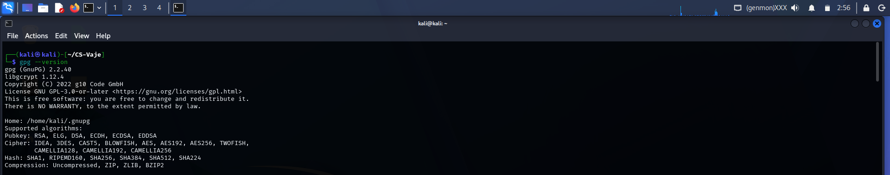
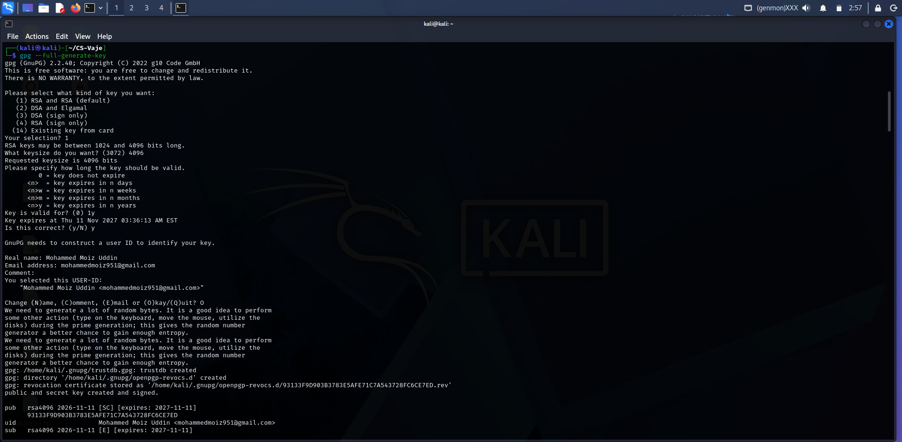
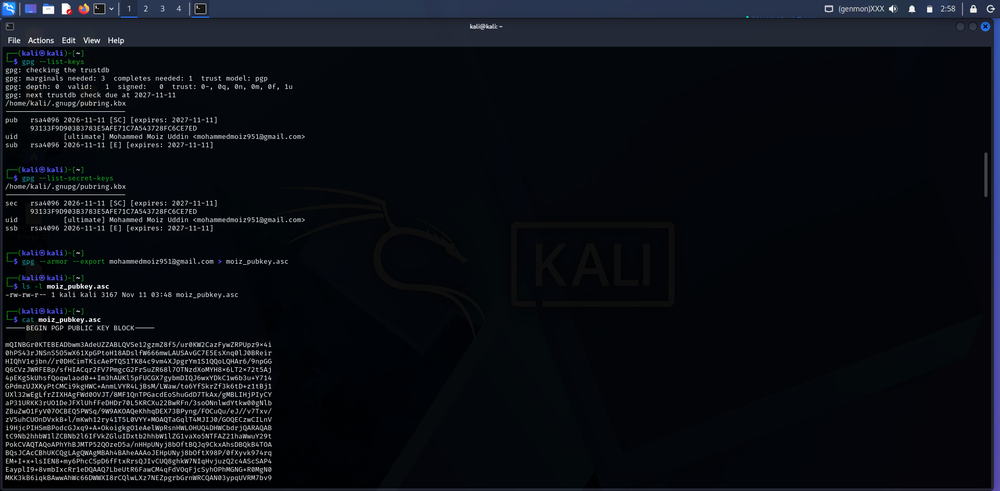
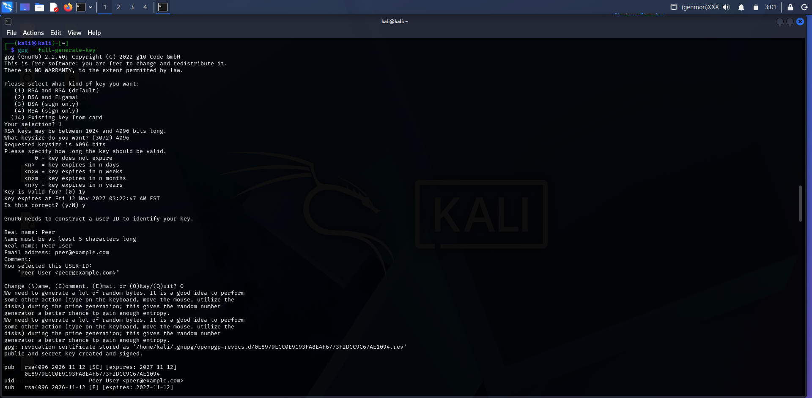
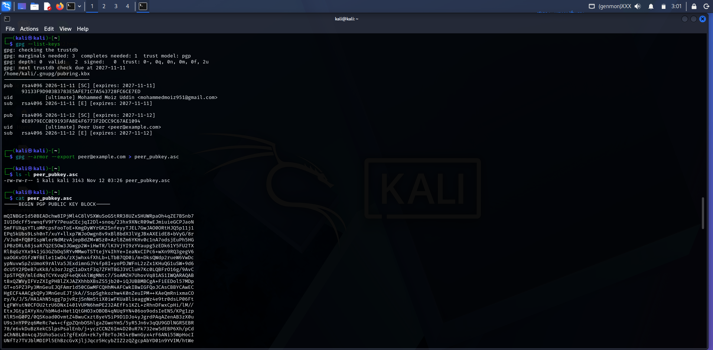
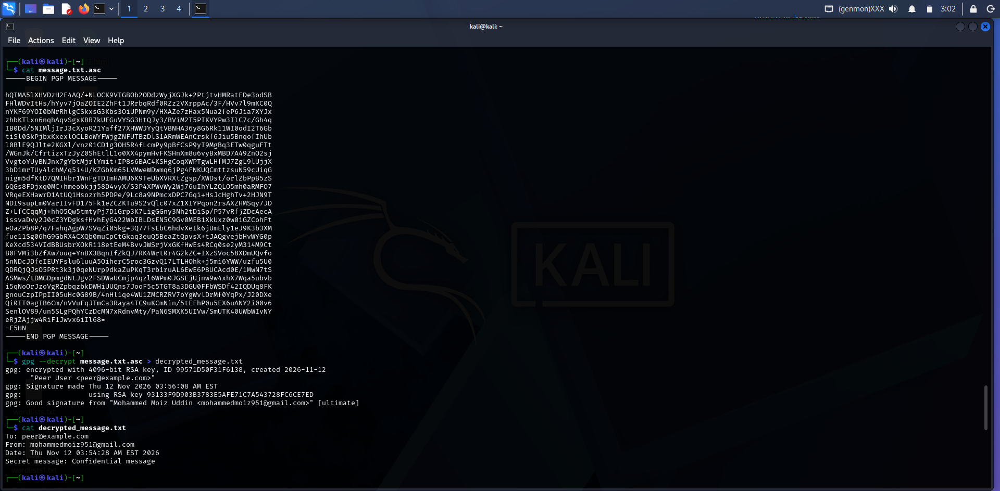
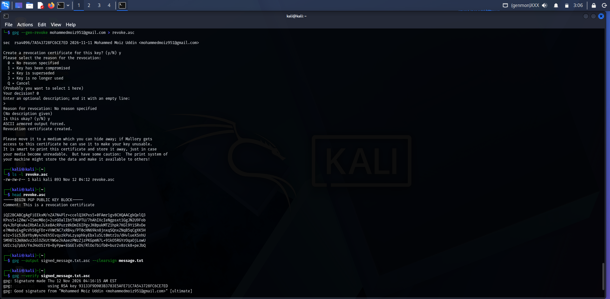

# Lab 04: GPG Key Generation, Encryption, and Signing

**Name:** Mohammed Moiz Uddin
**Environment:** Kali Linux, GnuPG 2.2.40

---

## 0) Check GPG version

```bash
gpg --version
```

```
gpg (GnuPG) 2.2.40
libgcrypt 1.12.4
Copyright (C) 2022 g10 Code GmbH
License GNU GPL-3.0-or-later <https://gnu.org/licenses/gpl.html>
This is free software: you are free to change and redistribute it.
There is NO WARRANTY, to the extent permitted by law.

Home: /home/kali/.gnupg
Supported algorithms:
Pubkey: RSA, ELG, DSA, ECDH, ECDSA, EDDSA
Cipher: IDEA, 3DES, CAST5, BLOWFISH, AES, AES192, AES256, TWOFISH,
        CAMELLIA128, CAMELLIA192, CAMELLIA256
Hash: SHA1, RIPEMD160, SHA256, SHA384, SHA512, SHA224
Compression: Uncompressed, ZIP, ZLIB, BZIP2
```



---

## 1) Generate GPG key pair

```bash
gpg --full-generate-key
```

```
gpg (GnuPG) 2.2.40; Copyright (C) 2022 g10 Code GmbH
This is free software: you are free to change and redistribute it.
There is NO WARRANTY, to the extent permitted by law.

Please select what kind of key you want:
   (1) RSA and RSA (default)
   (2) DSA and Elgamal
   (3) DSA (sign only)
   (4) RSA (sign only)
  (14) Existing key from card
Your selection? 1
RSA keys may be between 1024 and 4096 bits long.
What keysize do you want? (3072) 4096
Requested keysize is 4096 bits
Please specify how long the key should be valid.
         0 = key does not expire
      <n>  = key expires in n days
      <n>w = key expires in n weeks
      <n>m = key expires in n months
      <n>y = key expires in n years
Key is valid for? (0) 1y
Key expires at Thu 11 Nov 2027 03:36:13 AM EST
Is this correct? (y/N) y

GnuPG needs to construct a user ID to identify your key.

Real name: Mohammed Moiz Uddin
Email address: mohammedmoiz951@gmail.com
Comment:
You selected this USER-ID:
    "Mohammed Moiz Uddin <mohammedmoiz951@gmail.com>"

Change (N)ame, (C)omment, (E)mail or (O)kay/(Q)uit? O
We need to generate a lot of random bytes. It is a good idea to perform
some other action (type on the keyboard, move the mouse, utilize the
disks) during the prime generation; this gives the random number
generator a better chance to gain enough entropy.
We need to generate a lot of random bytes. It is a good idea to perform
some other action (type on the keyboard, move the mouse, utilize the
disks) during the prime generation; this gives the random number
generator a better chance to gain enough entropy.
gpg: /home/kali/.gnupg/trustdb.gpg: trustdb created
gpg: directory '/home/kali/.gnupg/openpgp-revocs.d' created
gpg: revocation certificate stored as '/home/kali/.gnupg/openpgp-revocs.d/93133F9D903B3783E5AFE71C7A543728FC6CE7ED.rev'
public and secret key created and signed.

pub   rsa4096 2026-11-11 [SC] [expires: 2027-11-11]
      93133F9D903B3783E5AFE71C7A543728FC6CE7ED
uid                      Mohammed Moiz Uddin <mohammedmoiz951@gmail.com>
sub   rsa4096 2026-11-11 [E] [expires: 2027-11-11]
```



### Check keys

```bash
cd
gpg --list-keys
```

```
gpg: checking the trustdb
gpg: marginals needed: 3  completes needed: 1  trust model: pgp
gpg: depth: 0  valid:   1  signed:   0  trust: 0-, 0q, 0n, 0m, 0f, 1u
gpg: next trustdb check due at 2027-11-11
/home/kali/.gnupg/pubring.kbx
-----------------------------
pub   rsa4096 2026-11-11 [SC] [expires: 2027-11-11]
      93133F9D903B3783E5AFE71C7A543728FC6CE7ED
uid           [ultimate] Mohammed Moiz Uddin <mohammedmoiz951@gmail.com>
sub   rsa4096 2026-11-11 [E] [expires: 2027-11-11]
```

```bash
gpg --list-secret-keys
```

```
/home/kali/.gnupg/pubring.kbx
-----------------------------
sec   rsa4096 2026-11-11 [SC] [expires: 2027-11-11]
      93133F9D903B3783E5AFE71C7A543728FC6CE7ED
uid           [ultimate] Mohammed Moiz Uddin <mohammedmoiz951@gmail.com>
ssb   rsa4096 2026-11-11 [E] [expires: 2027-11-11]
```



---

## 2) Export and import public key

### Export my public key

```bash
gpg --armor --export mohammedmoiz951@gmail.com > moiz_pubkey.asc
ls -l moiz_pubkey.asc
```

```
-rw-rw-r-- 1 kali kali 3167 Nov 11 03:48 moiz_pubkey.asc
```

```bash
cat moiz_pubkey.asc
```

```
-----BEGIN PGP PUBLIC KEY BLOCK-----

mQINBGr0KTEBEADbwm3AdeUZZABLQVSe12gzmZ8f5/ur0KW2CazFywZRPUpz9x4i
0hPS43rJNSnS5O5wX61XpGPtoH18ADslfW666mwLAUSAvGC7E5EsXnq0lJ0BReir
HIQhV1ejbn//r0DHCimTKicAePTQS1TK84c9vm4XJpgrYm1S1QQoLQHAr6/9npGG
Q6CVzJWRFEBp/sfHIACqr2FV7PmgcG2FrSuZR68l7OTNzdXoMYH8x6LT2x72t5Aj
4pEKg5kUhsfQoqwlaod0++Im3hAUKl5pFUCGX7gybmDIQJ6wxYDkC1w6b3u+Y714
GPdmzUJXKyPtCMCi9kgHWC+AnmLVYR4LjBsM/LWaw/to6YfSkrZf3k6tD+z1tBj1
UXl32wEgLfrZIXHAgFWd0OVJT/8MF1QnTPGacdEoShuGdD7TkAx/gMBLIHjPIyCY
aP31URKK3rUO1DeJFXlUhfFeDHDr70L5KRCXu22BwRFn/3soONnlwdYtkw00gNlb
ZBuZwO1FyV07OCBEQ5PWSq/9W9AKOAQeKhhqDEX73BPyng/FOCuQu/eJ//v7Txv/
zV5uhCUOnDVxkB+l/mKwh12ry41T5L0VYY+MOAQTaGqlT4MJIJ0/GOQECzwCILnV
i9HjcPIHSmBPodcGJxq9+A+OkoigkgO1eAelWpRsnHWLOHUQ4DHWCbdrjQARAQAB
tC9Nb2hhbW1lZCBNb2l6IFVkZGluIDxtb2hhbW1lZG1vaXo5NTFAZ21haWwuY29t
PokCVAQTAQoAPhYhBJMTP52QOzeD5a/nHHpUNyj8bOftBQJq9CkxAhsDBQkB4TOA
BQsJCAcCBhUKCQgLAgQWAgMBAh4BAheAAAoJEHpUNyj8bOftX98P/0fXyvk974rq
EM+I+x+lsIEN8+my6PhcCSpD6fFtxRrsQJIvCUQ8ghkW7NIqHvjuzQ2c4AScSAP4
EayplI9+8vmbIxcRr1eDQAAQ7LbeUtR6FawCM4qFdVOqFjcSyhOPhMGNG+R0MgN0
MKK3kB6iqkBAwwAhWc66DWWXI8rCQlwLXz7NEZpgrbGrnWRCQAN03ypqUVRM7bv9
3SbLGcDfEvaxhEf88Qw2+2iUBazNoHlu5nqr48RR+UkfnT67rXS+x0OEkPqyUDHL
o/C+/JYveRk1YOnmsJ+pFKndLHskOCNgwKveq7bnI+uVgYxCd/+xymu0/d+tKojO
9Aeg58119tdzQSB9fGgNQsP3u0ySnknUdnBXUAiiGj2JModyN8oPl7FAMkAAsOqt
EfL9hyaGqlAS58Ou2c/edNwy9DzlEbMMtm2WJgOI0zfX0KW2MD4MN2WaQqeiU7Zn
GhRGwGU7aolzTRTaSIePOb//bGmVcPC36EoNU0FfJieCt1c3ulT0ivQ1joSjklPM
9KW0kFgQ6njxcNmk41hQv4ZoyQ0ylJY4JiAH9TLVMnGS3zaKMz+8XZIc2KZ73AKm
nkZgqOaSBghnJs9+NQq4ZFwXzoV7BHutR7RfDsc/8y04T3T6zSmQttXBFuDIatNv
kTQcHaoDhLKTWZhWK8yBk8uF41WVTZbeuQINBGr0KTEBEACsvD5bmKYAtq4l342v
DPITPMS+lFFyIY+YyUzOg0sojdJMRyEnZ1shk+c1JGFUGPvpy6UKKtCFYwwMMauk
I64t6hSq0777NuOEgC7rG1dIWvgFa0D+EyrPSUKVfsjENe93g97ZQjO/aRJIGFGj
IlY8urBVxKp1VQV/305GLplNj24N4frOzrdUati+UmhoMEZNHIQbZpe5WlXZB6Ls
vjnHgwkl6fADblqver9a1wpew9zXsPpxLF5IzD3sv8dci2bbcTk4Om8DLAUlyxbq
6QqrvAqpfPFILS8qR861omjDFwd/wRoiKLMX0Dg8bmFxov8ZAScCzCPLpZnZnz5E
Mt/L+zBGp9kvrpEWDRrWvCaDsgaDceO10Da6I4UDV4Pni5pnzIW+tYlpxmgsKv6l
93GK6XYd66j5ro5VXbw56N7uPmgwe21DI3DzCnraP/K5tPuo1V16YmOZBdkX17IU
SrAK1N95q1Oy4bOArxNr63lGnZtVmENQ53zBFXqO84Gf56hf3eMc5hLz940wiPdx
IOseUgcURerNny3OrklX9ydNRk3z1Xq05x23mtK5vjLMyC32hyHLNzIr+nC6AU3l
PnesihfzrP9PcNBt4WlJufSWYTUQ0n7BcbEn8jucxH7T3K4F2m/lmFOu6s5ZZ6N6
HzYkM2tBzf1xHHeaFC064igepQARAQABiQI8BBgBCgAmFiEEkxM/nZA7N4Plr+cc
elQ3KPxs5+0FAmr0KTECGwwFCQHhM4AACgkQelQ3KPxs5+13SA/+Ow4kdKEfMu6y
PzYTTzbWIp1QriQRy1rNkT30lAYumuT42eQWb4gA9w1z/cqHWUafA29BUFuuT0yS
wWiiMs93lLAX3fE8VCMLSVAhkUnvjPFiCUKRYMzdWpn1d68FlkkosHsR6kmJRYwV
3rkomDo5LPxXSRKMq+O9obvpiwMqxALJ+4C7ewf/m0fJaHcOOLPQ8d8vF3S0xduk
l9wBmT+8vEk92TlSBPWere6X4Rzsco8NtAN3eaD1LdTNWqAAGq/T5n/ZxJCv5tSq
nTkj8PjUi39OH1osfTtsw4geGHhOMH1mD5GiIjdaJE15g9TTvnPte/BYAByUc42B
1kvIT6obzIMd3vPCwobcOQB6LubUmqQ4n2DecnoRVAErfmeWF+Az+itH9JSj38W7
6YLdbn+d/Iw/mo1N16MM9qVTKOyISdlSy1LKwuPpmKbQwnMz+Mu022/xqRr0SOCs
7BnieG6tGjk/o4Ob4n77Ae2RmMjZf2nXYrR+a+K7dE4nvvZUqKGBt0M6UQdBc7cG
iEqtuSByDrWbG3/PGILNE9vrxjUI0CJz96SgyV8xeMDXjPAkl3Or0cVwIjKJOji8
Gsybnd4BQn4mAz8pnHyqAk11PLHf/m2STQabjr/gPo8sRwdfSZAf+gAJWj8K/kSN
Rt3r8y/3hmH0pj5t54NfV848pqMMbqk=
=4QUY
-----END PGP PUBLIC KEY BLOCK-----

```


### Create a second identity (the "peer")

I did not have a foreign public key, so, following the tip in the assignment, I created another key pair of my own with a different identity.

```bash
gpg --full-generate-key
```

```
gpg (GnuPG) 2.2.40; Copyright (C) 2022 g10 Code GmbH
This is free software: you are free to change and redistribute it.
There is NO WARRANTY, to the extent permitted by law.

Please select what kind of key you want:
   (1) RSA and RSA (default)
   (2) DSA and Elgamal
   (3) DSA (sign only)
   (4) RSA (sign only)
  (14) Existing key from card
Your selection? 1
RSA keys may be between 1024 and 4096 bits long.
What keysize do you want? (3072) 4096
Requested keysize is 4096 bits
Please specify how long the key should be valid.
         0 = key does not expire
      <n>  = key expires in n days
      <n>w = key expires in n weeks
      <n>m = key expires in n months
      <n>y = key expires in n years
Key is valid for? (0) 1y
Key expires at Fri 12 Nov 2027 03:22:47 AM EST
Is this correct? (y/N) y

GnuPG needs to construct a user ID to identify your key.

Real name: Peer
Name must be at least 5 characters long
Real name: Peer User
Email address: peer@example.com
Comment:
You selected this USER-ID:
    "Peer User <peer@example.com>"

Change (N)ame, (C)omment, (E)mail or (O)kay/(Q)uit? O
We need to generate a lot of random bytes. It is a good idea to perform
some other action (type on the keyboard, move the mouse, utilize the
disks) during the prime generation; this gives the random number
generator a better chance to gain enough entropy.
We need to generate a lot of random bytes. It is a good idea to perform
some other action (type on the keyboard, move the mouse, utilize the
disks) during the prime generation; this gives the random number
generator a better chance to gain enough entropy.
gpg: revocation certificate stored as '/home/kali/.gnupg/openpgp-revocs.d/0E8979ECC0E9193FA8E4F6773F2DCC9C67AE1094.rev'
public and secret key created and signed.

pub   rsa4096 2026-11-12 [SC] [expires: 2027-11-12]
      0E8979ECC0E9193FA8E4F6773F2DCC9C67AE1094
uid                      Peer User <peer@example.com>
sub   rsa4096 2026-11-12 [E] [expires: 2027-11-12]
```

```bash
gpg --list-keys
```

```
gpg: checking the trustdb
gpg: marginals needed: 3  completes needed: 1  trust model: pgp
gpg: depth: 0  valid:   2  signed:   0  trust: 0-, 0q, 0n, 0m, 0f, 2u
gpg: next trustdb check due at 2027-11-11
/home/kali/.gnupg/pubring.kbx
-----------------------------
pub   rsa4096 2026-11-11 [SC] [expires: 2027-11-11]
      93133F9D903B3783E5AFE71C7A543728FC6CE7ED
uid           [ultimate] Mohammed Moiz Uddin <mohammedmoiz951@gmail.com>
sub   rsa4096 2026-11-11 [E] [expires: 2027-11-11]

pub   rsa4096 2026-11-12 [SC] [expires: 2027-11-12]
      0E8979ECC0E9193FA8E4F6773F2DCC9C67AE1094
uid           [ultimate] Peer User <peer@example.com>
sub   rsa4096 2026-11-12 [E] [expires: 2027-11-12]
```



### Export the peer's public key

```bash
gpg --armor --export peer@example.com > peer_pubkey.asc
ls -l peer_pubkey.asc
```

```
-rw-rw-r-- 1 kali kali 3143 Nov 12 03:26 peer_pubkey.asc
```

```bash
cat peer_pubkey.asc
```

```
-----BEGIN PGP PUBLIC KEY BLOCK-----

mQINBGr1d50BEADchw8IPjMl4C8lVSXWuSoGStRR38UZxSHUWRpaOh4qZE7BSnb7
IU1DdcFf5vwnqfV9FY7PeuaCEcjqI2Dl+snoq/23hx9XNcR09wEJmiuieGCPJaoN
SmFFUXqsYTLoMPcpsFooToE+KmgDyWYrGK2SnfeyyTJEL7GwJAO0ORtHJQ5p11j1
EPq5kUbs9Lsh0nT/xuY+llxp7WJoOwgn8v9xBl8bdX3lVgJBxAXEidE8+bVyG/8r
/VJu0xFQBPIspWlerNdMzvAjepBdZM+WSz0xArl8Zm6YKHv0c1nA7odsjEuPh5HG
iPBzDRL68jsaR7Q2ESOw3JGwgp2W+iHwTR/lK3VjYI9zYVaupg5zEDk61Y5FU2TX
RlBqGzYXx941jG3GZbDq5RYvMMwoTSTtejY4IhYe+IeaNxCIPc6+wXn9RQ3gegV6
uaOGKvOSfzWfBEle11wD4/zXjwhx4fXhLb+LTbB7QD0i/m+DksQWdp2rueW6VwDc
ypNuvwSpZsUmoK9rAlVa5JExdimnGJY4fp8I+yoPDJWFnL2zZx1KHuQG1uSW+9d6
dcU5Y2PDeB7uKk8/s3orJzgC1aDxtF3q7ZFHT8GJ3VCluH7Kc0LQBFrO16g/9AvC
3pSTPQ9/mlEdNqTCYKvqQF4eQK4klWgMNtc7/SoAMZH7UhovVq81AS1IWQARAQAB
tBxQZWVyIFVzZXIgPHBlZXJAZXhhbXBsZS5jb20+iQJUBBMBCgA+FiEEDol57MDp
GT+o5PZ3Py3MnGeuEJQFAmr1d50CGwMFCQHhM4AFCwkIBwIGFQoJCAsCBBYCAwEC
HgECF4AACgkQPy3MnGeuEJTjkA//SspSghkozhw4K0nZeuIPM++KAeQmRnixmaCO
ry/k/J/S/HA1AhN5sgg7pjvRzjSnNm5tiX0iwFKUaBlieaggWz4e9tr0dsLP06Ft
LgFWYutN0CFOU2trU6DNxI401VUPN6hmPE232AEfFs1KZL+zRhnDFwxCpHi/lM//
EtxJGtyIAYyXn/hbM4d+Het1QtGHO3xOBOB4qNUq9YN406oo9odsIeENS/KPg1zp
KlR5nG0P2/0QSKoad0OvmtZ4BwuCxzt8yeVSiP9D1DJo4yJgrdPAqAZenAB3zX0u
U9s3nYPPzq6MeRc7w4+cfgpZQnbOShlgaZGwoYmS/5yR5Jn6v3qQU9GDlNGRSEBR
78/e6vkDuBzXekCSlpsPsalEnb/j+yczCCNZ6Im4D20uR7k732ew5dEBP6Xh/pCd
aChN8L0n4cqJSUhoSacu17gfExGh+rk7yfBrToJK54rBwnGyx4rF6ANi55WpHocI
UNfTz7TVJblMDIPl5EhBzcGvXjljJqcr5HcybZIZ2zQZgcpAbYD01n9YVIM/htWe
UYbfb8xH9iMocJfheUUibHxHRCOH2lxafIiyzsalYkT2b8OB1PTvFcEYPfSd4egJ
bC+s+kwHYC6yAu8vNt3/l6FxiDUSWGn6p0OKWEGVoSicjBXyCtWTMxhAeaGticYI
2dKBidq5Ag0EavV3nQEQALdwnR4mIkyGxVKi1rQJXXxAToOi0hVGlZ+IOG5QN/pg
QUXeYuBN9/FnVRzAK8RWzqb8m6ToLDd49+a0iq4i90qkzF98PLtSklm5hO/tpdLO
Vx3974mwD7J2oeXON5nJ0b9WfgVQo7KH8jDI+rFga4acBELhKS/UFx3VtSV9OxE5
xd0h8EE6j4kI4IAvcOHu81fIec9mjO3xj+XLplTS41ZsDm2k0uICevGb3GlSGbJI
Ku5zu5oN/BAZlyhM1wFM6Lz1uOL0NfkYQF8tBhwae7GpzpdcYFp8FujnkP9soecm
InTBn3OY5vS1Y3hr04j3ikaG41GP74YCcVD5IVYSZ6iciSMzI4ZdZ2y6lRUMZCKk
4m+aZKOL1YM+KGTtrEQvWJVe5Fms13d/9VllXjTyq8QLBQQdsqi7nD3IMHJ9zueI
zHQ0iNOApe2siBZSbPSNlZbpIkyDeDqWBg6nPzvxpt1KlEkDsqdI1PZVwWPpkVof
vmgrX/xjnwOf+1oNcGRGT00z+ES82kz/JWm4nXXq1rk9bQwdREpGd0ld6Ianv6HA
+oIfWbV04TfjTdRst21HwC/HifpYqZb7YWT0IP+DNOJh4tgYDNkfkuacdYkVXPX5
LWv4PRpJXEH3uaYeNt9shsnY2ywNB209Bf0MOTou+aZPvjKcYcwhIVC/FN/0pLxN
ABEBAAGJAjwEGAEKACYWIQQOiXnswOkZP6jk9nc/LcycZ64QlAUCavV3nQIbDAUJ
AeEzgAAKCRA/LcycZ64QlEWfD/wJ9GLHcG5coIcur1vKTEHkHxhyPYpKo1tmjiwH
gqfcX2/DnI8Nc5+OT7W+RwD1j/JNkCyk9+oQq46COwsYs0xXjE3xvNenux+wijLt
QAO41hX0zMRH+vv4R4bJ5vMstLBJLuomFl+rF1oHRCsOtsq5Oli3HElZNFOMe9p/
f4u/gkVtdp9povbIeW/xzdr4k6LfGOhfbRwShPJ8OCjO7pgzzL/UdoL4Gcf8C8xd
WxXG8N9MGgFbHgB+x+sbW/fLqtr0BJn/hiRuhvBVRUvgUmSkZOmHAJGIUIzoedH2
xjqJmcG9/wm6IAokDStdZQXwVFIXbxS8mm1pJuwCxMIMm4ps04AMqiodmIYPStD/
BASQkl6BwytPMnyL44nZupT2THmsbH69fHPvr5Tyw4RjDu67xresCF8EsJyWOYXe
xNqSZ/9VLflpNgkMAFMT8phAeps449rejnhfn2v+f1uaPr8tj+jQq+fw5WQd9Kby
FrvOuBy06DcwcTvt55x/UUqQrcfKkSVg/26Cs7w/G16f804q0tHwQonniUVgPg3q
iNjXN34wtom+eBbtxdKdUhhvmdfV0aceNVHBkeMW+QlTeCHgz/lrrtEOZXiUn6hD
oRYDxWAZ6JMbAbeXrKF1yfR08aN5/rf9jsYy6aNgc1pMKDIusjSWxbAkTe+k0T0p
HOfFng==
=XCBF
-----END PGP PUBLIC KEY BLOCK-----

```




### Import the peer's public key

```bash
gpg --import peer_pubkey.asc
```

```
gpg: key 3F2DCC9C67AE1094: "Peer User <peer@example.com>" not changed
gpg: Total number processed: 1
gpg:              unchanged: 1
```

**Note:** The import reports "not changed" because the peer key was created in the same keyring, so it was already present.

### Verification

```bash
gpg --list-keys
```

```
/home/kali/.gnupg/pubring.kbx
-----------------------------
pub   rsa4096 2026-11-11 [SC] [expires: 2027-11-11]
      93133F9D903B3783E5AFE71C7A543728FC6CE7ED
uid           [ultimate] Mohammed Moiz Uddin <mohammedmoiz951@gmail.com>
sub   rsa4096 2026-11-11 [E] [expires: 2027-11-11]

pub   rsa4096 2026-11-12 [SC] [expires: 2027-11-12]
      0E8979ECC0E9193FA8E4F6773F2DCC9C67AE1094
uid           [ultimate] Peer User <peer@example.com>
sub   rsa4096 2026-11-12 [E] [expires: 2027-11-12]
```


---

## 3) Preparing the message

```bash
echo "To: peer@example.com
From: mohammedmoiz951@gmail.com
Date: $(date)
Secret message: Confidential message" > message.txt
```

```bash
cat message.txt
```

```
To: peer@example.com
From: mohammedmoiz951@gmail.com
Date: Thu Nov 12 03:54:28 AM EST 2026
Secret message: Confidential message
```

---

## 4) Encrypting and signing

```bash
gpg --encrypt --sign --armor --recipient peer@example.com message.txt
```

```bash
ls -l message.txt message.txt.asc
```

```
-rw-rw-r-- 1 kali kali  128 Nov 12 03:54 message.txt
-rw-rw-r-- 1 kali kali 1841 Nov 12 03:56 message.txt.asc
```

```bash
cat message.txt.asc
```

```
-----BEGIN PGP MESSAGE-----

hQIMA5lXHVDzH2E4AQ/+NLOCK9VIGBOb2ODdzWyjXGJk+2PtjtvHMRatEDe3odSB
FHlWDvItHs/hYyv7jOaZOIE2ZhFt1JRrbqRdf0RZz2VXrppAc/3F/HVv7l9mKC0Q
nYKF69YOI0bNrRhlgCSkxsG3Kbs3OiUPNm9y/HXAZe7zHax5Nua2feP6Jia7XYJx
zhbKTlxn6nqhAqvSgxKBR7kUEGuVYSG3HtQJy3/BViM2T5PIKVYPw3IlC7c/Gh4q
IB0Dd/5NIMljIrJ3cXyoR21Yaff27XHWWJYyQtVBNHA36y8G6Rk11WI0odI2T6Gb
tiSl0SkPjbxKxexlOCLBoWYFWjgZNFUTBzDlS1ARmWEAnCrskf6Jiu5BnqofIhUb
l0BlE9QJlte2KGXl/vnz01CD1g3OH5R4fLcmPy9pBfCsP9yI9MgBq3ETw0qguFTt
/WGnJk/CfrtizxTzJyZ0ShEtlL1o0XX4pymHvFKSHnXm8u6vyBxMBD7A49ZnO2sj
VvgtoYUyBNJnx7gYbtMjrlYmit+IP8s6BAC4KSHgCoqXWPTgwLHfMJ7ZgL9lUjjX
3bD1mrTUy4lchM/q5i4U/KZGbKm65LVMweWDwmq6jPg4FNKUQCmttzsuN59cUiqG
nigm5dfKtD7QMIHbr1WnFgTDImHAMU6K9TeUbXVRXtZgsp/XWDst/orlZbPpB5zS
6QGs8FDjxq0MC+hmeobkjj58D4vyX/S3P4XPWvWy2Wj76uIhYLZQLO5mh0aRMFO7
VRqeEXHawrD1AtUQ1Hsozrh5PDPe/9Lc8a9NPmcxDPC7Gqi+HsJcHghTv+2HJN9T
NDI9supLm0VarIIvFD175Fk1eZCZKTu9S2vQlc07xZ1XIYPqon2rsAXZHMSqy7JD
Z+LfCCqqMj+hhO5Qw5tmtyPj7D1Grp3K7LigGGny3Nh2tDiSp/P57vRfjZDcAecA
issvaDvy2J0cZ3YDgksfHvhEyG422WbIBLDsEN5C9Gv0MEB1XkUxz0w0iGZCohFt
eOaZPb8P/q7FahqAgpW7SVqZi05kg+3Q77FsEbC6hdvXeIk6jUmEly1eJ9K3b3XM
fue11Sg06hG9GbRX4CXQb0muCpCtGkaq3euQ5BeaZtQpvsX+tJAQgvejbHvWYG0p
KeXcd534VIdBBUsbrXOkRi18etEeM4BvvJWSrjVxGKfHwEs4RCq0se2yM314M9Ct
B0FVMi3bZfXw7ouq+YnBX3BqnIfZkQJ7RK4Wrt0r4G2kZC+IXzSVoc58XDmUQvfo
5nNDcJDfeIEUYFslu6luuA5OiherC5roc3GzvQ17LTLHOhk+j5mi6YWW/uzfu5U0
QDRQjQJsO5PRt3k3j0qeNUrp9dkaZuPKqT3rb1ruAL6EwE6P8UCAcd0E/1MwN7tS
ASMws/tDMGDpmgdNtJgv2FSDWaUCmjp4qzl6WPm0JGSEjUjnw9w4xhX7Wqa5ubvb
i5qNoOrJzoVgRZpbqzbkDWHiUUQns7JooF5c5TGT8a3DGU0FFbWSDf42IQDUq8FK
gnouCzpIPpII05uHc0G89B/4nHl1qe4WU1ZMCRZRV7oYgWvlDrMf0YqPx/J20DXe
Qi0IT0agIB6Cm/nVVuFqJTmCa3Raya4TC9uKCmNin/5tEFhP0u5EX6uANY2i00v6
SenlOV89/un5SLgPQhYCzDcMN7xRdnvMty/PaN6SMXK5UIVw/SmUTK40UWbWIvNY
eRjZAjjw4RiF1Jwvx6iIl68=
=E5HN
-----END PGP MESSAGE-----

```

The output is unreadable ciphertext, which confirms the message is encrypted.


---

## 5) Decrypting and verifying the signature

```bash
gpg --decrypt message.txt.asc > decrypted_message.txt
```

```
gpg: encrypted with 4096-bit RSA key, ID 99571D50F31F6138, created 2026-11-12
      "Peer User <peer@example.com>"
gpg: Signature made Thu 12 Nov 2026 03:56:08 AM EST
gpg:                using RSA key 93133F9D903B3783E5AFE71C7A543728FC6CE7ED
gpg: Good signature from "Mohammed Moiz Uddin <mohammedmoiz951@gmail.com>" [ultimate]
```

```bash
cat decrypted_message.txt
```

```
To: peer@example.com
From: mohammedmoiz951@gmail.com
Date: Thu Nov 12 03:54:28 AM EST 2026
Secret message: Confidential message
```

The decrypted text matches the original message, and GPG reports a **Good signature**.



---

## Additional tasks

### Revocation certificate

```bash
gpg --gen-revoke mohammedmoiz951@gmail.com > revoke.asc
```

```
sec  rsa4096/7A543728FC6CE7ED 2026-11-11 Mohammed Moiz Uddin <mohammedmoiz951@gmail.com>

Create a revocation certificate for this key? (y/N) y
Please select the reason for the revocation:
  0 = No reason specified
  1 = Key has been compromised
  2 = Key is superseded
  3 = Key is no longer used
  Q = Cancel
(Probably you want to select 1 here)
Your decision? 0
Enter an optional description; end it with an empty line:
>
Reason for revocation: No reason specified
(No description given)
Is this okay? (y/N) y
ASCII armored output forced.
Revocation certificate created.

Please move it to a medium which you can hide away; if Mallory gets
access to this certificate he can use it to make your key unusable.
It is smart to print this certificate and store it away, just in case
your media become unreadable.  But have some caution:  The print system of
your machine might store the data and make it available to others!
```

```bash
ls -l revoke.asc
```

```
-rw-rw-r-- 1 kali kali 893 Nov 12 04:12 revoke.asc
```

```bash
head revoke.asc
```

```
-----BEGIN PGP PUBLIC KEY BLOCK-----
Comment: This is a revocation certificate

iQI2BCABCgAgFiEEkxM/nZA7N4Plr+ccelQ3KPxs5+0FAmr1gv8CHQAACgkQelQ3
... (truncated, the certificate itself should be kept private) ...
```

### Signing only (no encryption)

I used `--output` so the clearsigned file would not overwrite the encrypted `message.txt.asc` from step 4.

```bash
gpg --output signed_message.txt.asc --clearsign message.txt
```

### Verifying the signature

```bash
gpg --verify signed_message.txt.asc
```

```
gpg: Signature made Thu 12 Nov 2026 04:16:15 AM EST
gpg:                using RSA key 93133F9D903B3783E5AFE71C7A543728FC6CE7ED
gpg: Good signature from "Mohammed Moiz Uddin <mohammedmoiz951@gmail.com>" [ultimate]
```



### Files created

```bash
ls -lh ~/moiz_pubkey.asc ~/peer_pubkey.asc ~/message.txt ~/message.txt.asc ~/decrypted_message.txt ~/revoke.asc ~/signed_message.txt.asc
```

```
-rw-rw-r-- 1 kali kali  128 Nov 12 04:00 /home/kali/decrypted_message.txt
-rw-rw-r-- 1 kali kali  128 Nov 12 03:54 /home/kali/message.txt
-rw-rw-r-- 1 kali kali 1.8K Nov 12 03:56 /home/kali/message.txt.asc
-rw-rw-r-- 1 kali kali 3.1K Nov 11 03:48 /home/kali/moiz_pubkey.asc
-rw-rw-r-- 1 kali kali 3.1K Nov 12 03:26 /home/kali/peer_pubkey.asc
-rw-rw-r-- 1 kali kali  893 Nov 12 04:12 /home/kali/revoke.asc
-rw-rw-r-- 1 kali kali 1010 Nov 12 04:16 /home/kali/signed_message.txt.asc
```

---

## Short answers

**1. Difference between encryption and signing**
Encryption provides confidentiality: it makes the message unreadable to anyone except the intended recipient, using the recipient's public key. Signing provides authentication and integrity: it proves who created the message and that it was not changed, using the sender's private key. Encryption hides the content, while signing proves its origin and that it is unaltered.

**2. Role of public and private key**
The public key can be shared with anyone. It is used to encrypt data for the key's owner and to verify the owner's signatures. The private key must stay secret. It is used to decrypt data sent to the owner and to create the owner's digital signatures. In this lab, the message was encrypted with the peer's public key and signed with my private key.

**3. What happens when an encrypted file is modified**
If an encrypted file is modified, GPG's integrity protection may detect the alteration and report an error during decryption. Since this message was also digitally signed, modifying the signed content would cause signature verification to fail with a BAD signature result. This demonstrates how integrity protection helps detect unauthorized modifications.

---

## Conclusion

In this lab I used GnuPG on Kali Linux to generate an RSA 4096-bit key pair, create a second "peer" identity, and exchange public keys. I then encrypted and signed a message for the peer, decrypted it, and verified my signature with a `Good signature` result. As additional tasks, I created a revocation certificate and used `--clearsign` and `--verify` to sign a message without encrypting it.

The lab showed how the two main uses of asymmetric cryptography work together. Encryption with the recipient's public key provides **confidentiality**, and a signature made with the sender's private key provides **authentication and integrity**. It also showed that the private key never has to be shared, and that a revocation certificate should be created in advance and stored safely in case the key is lost or compromised.

I ran into a key generation timeout on the first attempt, caused by the random-number (entropy) generation taking too long. Retrying fixed it. The peer key was created in the same keyring, so the import reported "not changed", while a key from a separate keyring would have shown as newly imported.
