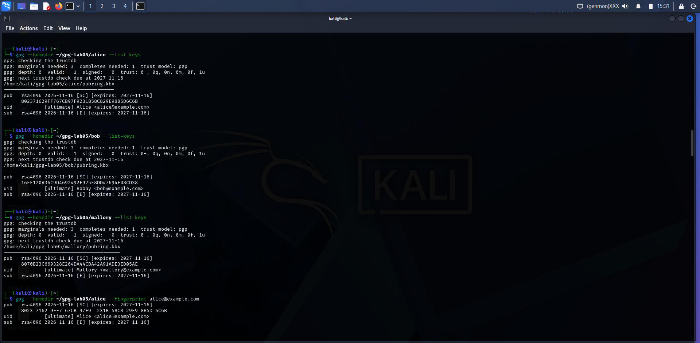
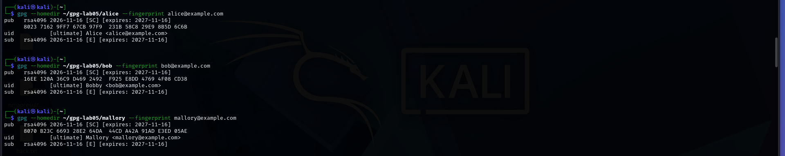
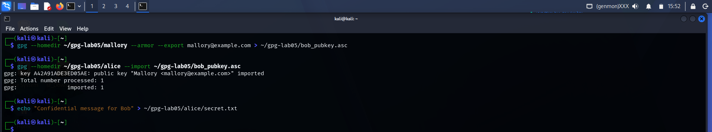
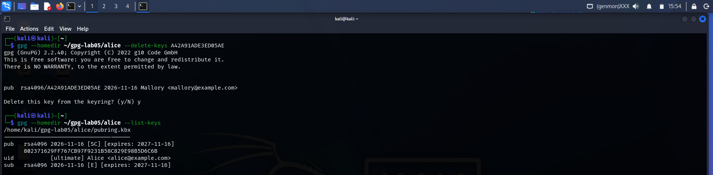
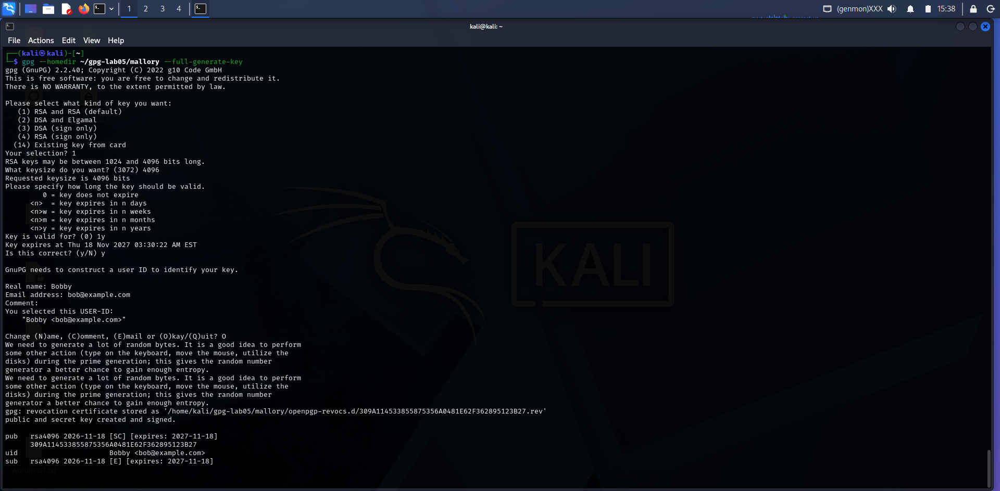
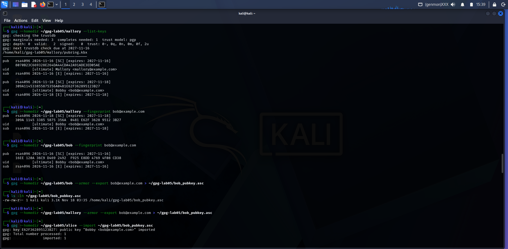
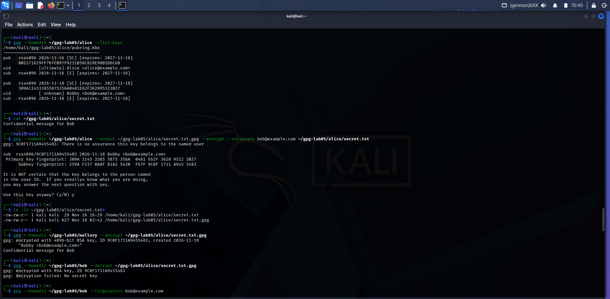
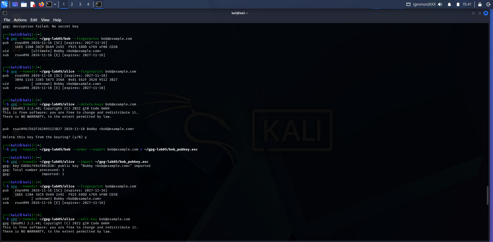
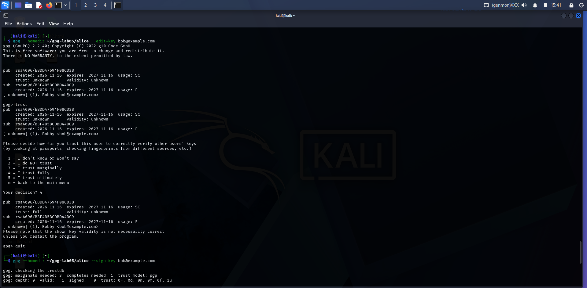
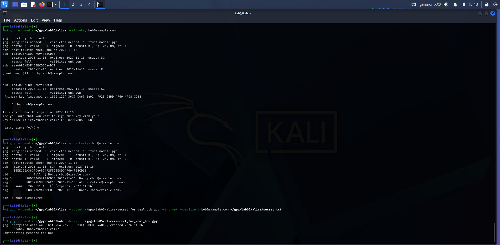

# Lab 05: Identifying MITM Attacks on GPG Keys (Web of Trust)

**Name:** Mohammed Moiz Uddin
**Environment:** Kali Linux, GnuPG 2.2.40

All terminal sections below are copied exactly as run, in the order they were executed.

---

## 1. Objective

To show that:

- a public key by itself does not imply trust,
- a MITM attacker can substitute a key during key exchange,
- fingerprint verification is what detects the attack,
- the Web of Trust (signing and trust levels) helps prevent it.

## 2. Note on approach

As approved by the professor, I used a separate `--homedir` per user, a shared folder as the insecure channel, a Mallory key with Bob's name and email (`Bobby <bob@example.com>`), and trust level 4 instead of 5. GnuPG requires a real name of at least 5 characters, so Bob's key uses the name Bobby.

---

## 3. Setup: directories

```
┌──(kali㉿kali)-[~]
└─$ mkdir -p ~/gpg-lab05/alice

┌──(kali㉿kali)-[~]
└─$ mkdir -p ~/gpg-lab05/bob

┌──(kali㉿kali)-[~]
└─$ mkdir -p ~/gpg-lab05/mallory

┌──(kali㉿kali)-[~]
└─$ chmod 700 ~/gpg-lab05

┌──(kali㉿kali)-[~]
└─$ chmod 700 ~/gpg-lab05/alice ~/gpg-lab05/bob ~/gpg-lab05/mallory
```

## 4. Key generation

### 4.1 Alice

```
┌──(kali㉿kali)-[~]
└─$ gpg --homedir ~/gpg-lab05/alice --full-generate-key
gpg (GnuPG) 2.2.40; Copyright (C) 2022 g10 Code GmbH
This is free software: you are free to change and redistribute it.
There is NO WARRANTY, to the extent permitted by law.

gpg: keybox '/home/kali/gpg-lab05/alice/pubring.kbx' created
Please select what kind of key you want:
   (1) RSA and RSA (default)
   (2) DSA and Elgamal
   (3) DSA (sign only)
   (4) RSA (sign only)
  (14) Existing key from card
Your selection? 1
RSA keys may be between 1024 and 4096 bits long.
What keysize do you want? (3072) 4096
Requested keysize is 4096 bits
Please specify how long the key should be valid.
         0 = key does not expire
      <n>  = key expires in n days
      <n>w = key expires in n weeks
      <n>m = key expires in n months
      <n>y = key expires in n years
Key is valid for? (0) 1y
Key expires at Tue 16 Nov 2027 04:02:55 PM EST
Is this correct? (y/N) y

GnuPG needs to construct a user ID to identify your key.

Real name: Alice
Email address: alice@example.com
Comment: 
You selected this USER-ID:
    "Alice <alice@example.com>"

Change (N)ame, (C)omment, (E)mail or (O)kay/(Q)uit? O
We need to generate a lot of random bytes. It is a good idea to perform
some other action (type on the keyboard, move the mouse, utilize the
disks) during the prime generation; this gives the random number
generator a better chance to gain enough entropy.
We need to generate a lot of random bytes. It is a good idea to perform
some other action (type on the keyboard, move the mouse, utilize the
disks) during the prime generation; this gives the random number
generator a better chance to gain enough entropy.
gpg: /home/kali/gpg-lab05/alice/trustdb.gpg: trustdb created
gpg: directory '/home/kali/gpg-lab05/alice/openpgp-revocs.d' created
gpg: revocation certificate stored as '/home/kali/gpg-lab05/alice/openpgp-revocs.d/802371629FF767CB97F9231B58C829E98B5D6C6B.rev'
public and secret key created and signed.

pub   rsa4096 2026-11-16 [SC] [expires: 2027-11-16]
      802371629FF767CB97F9231B58C829E98B5D6C6B
uid                      Alice <alice@example.com>
sub   rsa4096 2026-11-16 [E] [expires: 2027-11-16]
```

### 4.2 Bob

```
┌──(kali㉿kali)-[~]
└─$ gpg --homedir ~/gpg-lab05/bob --full-generate-key
gpg (GnuPG) 2.2.40; Copyright (C) 2022 g10 Code GmbH
This is free software: you are free to change and redistribute it.
There is NO WARRANTY, to the extent permitted by law.

gpg: keybox '/home/kali/gpg-lab05/bob/pubring.kbx' created
Please select what kind of key you want:
   (1) RSA and RSA (default)
   (2) DSA and Elgamal
   (3) DSA (sign only)
   (4) RSA (sign only)
  (14) Existing key from card
Your selection? 1
RSA keys may be between 1024 and 4096 bits long.
What keysize do you want? (3072) 4096
Requested keysize is 4096 bits
Please specify how long the key should be valid.
         0 = key does not expire
      <n>  = key expires in n days
      <n>w = key expires in n weeks
      <n>m = key expires in n months
      <n>y = key expires in n years
Key is valid for? (0) 1y
Key expires at Tue 16 Nov 2027 04:04:21 PM EST
Is this correct? (y/N) y

GnuPG needs to construct a user ID to identify your key.

Real name: Bob
Name must be at least 5 characters long
Real name: Bobby
Email address: bob@example.com
Comment: 
You selected this USER-ID:
    "Bobby <bob@example.com>"

Change (N)ame, (C)omment, (E)mail or (O)kay/(Q)uit? O
We need to generate a lot of random bytes. It is a good idea to perform
some other action (type on the keyboard, move the mouse, utilize the
disks) during the prime generation; this gives the random number
generator a better chance to gain enough entropy.
We need to generate a lot of random bytes. It is a good idea to perform
some other action (type on the keyboard, move the mouse, utilize the
disks) during the prime generation; this gives the random number
generator a better chance to gain enough entropy.
gpg: /home/kali/gpg-lab05/bob/trustdb.gpg: trustdb created
gpg: directory '/home/kali/gpg-lab05/bob/openpgp-revocs.d' created
gpg: revocation certificate stored as '/home/kali/gpg-lab05/bob/openpgp-revocs.d/16EE120A36C9D4692492F925E8DD47694F08CD38.rev'
public and secret key created and signed.

pub   rsa4096 2026-11-16 [SC] [expires: 2027-11-16]
      16EE120A36C9D4692492F925E8DD47694F08CD38
uid                      Bobby <bob@example.com>
sub   rsa4096 2026-11-16 [E] [expires: 2027-11-16]
```

### 4.3 Mallory

```
┌──(kali㉿kali)-[~]
└─$ gpg --homedir ~/gpg-lab05/mallory --full-generate-key
gpg (GnuPG) 2.2.40; Copyright (C) 2022 g10 Code GmbH
This is free software: you are free to change and redistribute it.
There is NO WARRANTY, to the extent permitted by law.

gpg: keybox '/home/kali/gpg-lab05/mallory/pubring.kbx' created
Please select what kind of key you want:
   (1) RSA and RSA (default)
   (2) DSA and Elgamal
   (3) DSA (sign only)
   (4) RSA (sign only)
  (14) Existing key from card
Your selection? 1
RSA keys may be between 1024 and 4096 bits long.
What keysize do you want? (3072) 4096
Requested keysize is 4096 bits
Please specify how long the key should be valid.
         0 = key does not expire
      <n>  = key expires in n days
      <n>w = key expires in n weeks
      <n>m = key expires in n months
      <n>y = key expires in n years
Key is valid for? (0) 1y
Key expires at Tue 16 Nov 2027 04:05:44 PM EST
Is this correct? (y/N) y

GnuPG needs to construct a user ID to identify your key.

Real name: Mallory
Email address: mallory@example.com
Comment: 
You selected this USER-ID:
    "Mallory <mallory@example.com>"

Change (N)ame, (C)omment, (E)mail or (O)kay/(Q)uit? O
We need to generate a lot of random bytes. It is a good idea to perform
some other action (type on the keyboard, move the mouse, utilize the
disks) during the prime generation; this gives the random number
generator a better chance to gain enough entropy.
We need to generate a lot of random bytes. It is a good idea to perform
some other action (type on the keyboard, move the mouse, utilize the
disks) during the prime generation; this gives the random number
generator a better chance to gain enough entropy.
gpg: /home/kali/gpg-lab05/mallory/trustdb.gpg: trustdb created
gpg: directory '/home/kali/gpg-lab05/mallory/openpgp-revocs.d' created
gpg: revocation certificate stored as '/home/kali/gpg-lab05/mallory/openpgp-revocs.d/8070B23C669328E264DA44CDA42A91ADE3ED05AE.rev'
public and secret key created and signed.

pub   rsa4096 2026-11-16 [SC] [expires: 2027-11-16]
      8070B23C669328E264DA44CDA42A91ADE3ED05AE
uid                      Mallory <mallory@example.com>
sub   rsa4096 2026-11-16 [E] [expires: 2027-11-16]
```

## 5. Verify the keys

```
┌──(kali㉿kali)-[~]
└─$ gpg --homedir ~/gpg-lab05/alice --list-keys
gpg: checking the trustdb
gpg: marginals needed: 3  completes needed: 1  trust model: pgp
gpg: depth: 0  valid:   1  signed:   0  trust: 0-, 0q, 0n, 0m, 0f, 1u
gpg: next trustdb check due at 2027-11-16
/home/kali/gpg-lab05/alice/pubring.kbx
--------------------------------------
pub   rsa4096 2026-11-16 [SC] [expires: 2027-11-16]
      802371629FF767CB97F9231B58C829E98B5D6C6B
uid           [ultimate] Alice <alice@example.com>
sub   rsa4096 2026-11-16 [E] [expires: 2027-11-16]

┌──(kali㉿kali)-[~]
└─$ gpg --homedir ~/gpg-lab05/bob --list-keys
gpg: checking the trustdb
gpg: marginals needed: 3  completes needed: 1  trust model: pgp
gpg: depth: 0  valid:   1  signed:   0  trust: 0-, 0q, 0n, 0m, 0f, 1u
gpg: next trustdb check due at 2027-11-16
/home/kali/gpg-lab05/bob/pubring.kbx
------------------------------------
pub   rsa4096 2026-11-16 [SC] [expires: 2027-11-16]
      16EE120A36C9D4692492F925E8DD47694F08CD38
uid           [ultimate] Bobby <bob@example.com>
sub   rsa4096 2026-11-16 [E] [expires: 2027-11-16]

┌──(kali㉿kali)-[~]
└─$ gpg --homedir ~/gpg-lab05/mallory --list-keys
gpg: checking the trustdb
gpg: marginals needed: 3  completes needed: 1  trust model: pgp
gpg: depth: 0  valid:   1  signed:   0  trust: 0-, 0q, 0n, 0m, 0f, 1u
gpg: next trustdb check due at 2027-11-16
/home/kali/gpg-lab05/mallory/pubring.kbx
----------------------------------------
pub   rsa4096 2026-11-16 [SC] [expires: 2027-11-16]
      8070B23C669328E264DA44CDA42A91ADE3ED05AE
uid           [ultimate] Mallory <mallory@example.com>
sub   rsa4096 2026-11-16 [E] [expires: 2027-11-16]
```



*Screenshot 1: `--list-keys` for Alice, Bob and Mallory (all `[ultimate]`), followed by Alice's fingerprint*

## 6. Fingerprints (original keys)

```
┌──(kali㉿kali)-[~]
└─$ gpg --homedir ~/gpg-lab05/alice --fingerprint alice@example.com
pub   rsa4096 2026-11-16 [SC] [expires: 2027-11-16]
      8023 7162 9FF7 67CB 97F9  231B 58C8 29E9 8B5D 6C6B
uid           [ultimate] Alice <alice@example.com>
sub   rsa4096 2026-11-16 [E] [expires: 2027-11-16]

┌──(kali㉿kali)-[~]
└─$ gpg --homedir ~/gpg-lab05/bob --fingerprint bob@example.com
pub   rsa4096 2026-11-16 [SC] [expires: 2027-11-16]
      16EE 120A 36C9 D469 2492  F925 E8DD 4769 4F08 CD38
uid           [ultimate] Bobby <bob@example.com>
sub   rsa4096 2026-11-16 [E] [expires: 2027-11-16]

┌──(kali㉿kali)-[~]
└─$ gpg --homedir ~/gpg-lab05/mallory --fingerprint mallory@example.com
pub   rsa4096 2026-11-16 [SC] [expires: 2027-11-16]
      8070 B23C 6693 28E2 64DA  44CD A42A 91AD E3ED 05AE
uid           [ultimate] Mallory <mallory@example.com>
sub   rsa4096 2026-11-16 [E] [expires: 2027-11-16]
```



*Screenshot 2: fingerprints of Alice, Bob and Mallory*

---

## 7. First attempt: Mallory's own key (not a convincing attack)

Mallory exports her own key into Bob's file, and Alice imports it:

```
┌──(kali㉿kali)-[~]
└─$ gpg --homedir ~/gpg-lab05/mallory --armor --export mallory@example.com > ~/gpg-lab05/bob_pubkey.asc

┌──(kali㉿kali)-[~]
└─$ gpg --homedir ~/gpg-lab05/alice --import ~/gpg-lab05/bob_pubkey.asc
gpg: key A42A91ADE3ED05AE: public key "Mallory <mallory@example.com>" imported
gpg: Total number processed: 1
gpg:               imported: 1

┌──(kali㉿kali)-[~]
└─$ echo "Confidential message for Bob" > ~/gpg-lab05/alice/secret.txt
```

**Observation:** Alice sees the name **Mallory**, not Bob. The uid inside the key is `mallory@example.com`, so `--recipient bob@example.com` would not match it, and a careful user would notice immediately. A real attacker has to impersonate Bob's identity, so this key is removed from Alice's keyring:

```
┌──(kali㉿kali)-[~]
└─$ gpg --homedir ~/gpg-lab05/alice --delete-keys A42A91ADE3ED05AE
gpg (GnuPG) 2.2.40; Copyright (C) 2022 g10 Code GmbH
This is free software: you are free to change and redistribute it.
There is NO WARRANTY, to the extent permitted by law.


pub  rsa4096/A42A91ADE3ED05AE 2026-11-16 Mallory <mallory@example.com>

Delete this key from the keyring? (y/N) y

┌──(kali㉿kali)-[~]
└─$ gpg --homedir ~/gpg-lab05/alice --list-keys
/home/kali/gpg-lab05/alice/pubring.kbx
--------------------------------------
pub   rsa4096 2026-11-16 [SC] [expires: 2027-11-16]
      802371629FF767CB97F9231B58C829E98B5D6C6B
uid           [ultimate] Alice <alice@example.com>
sub   rsa4096 2026-11-16 [E] [expires: 2027-11-16]
```



*Screenshot 3: Mallory exports her own key, Alice imports it and sees `Mallory <mallory@example.com>`*



*Screenshot 4: Mallory's key deleted from Alice's keyring; only Alice's own key remains*

---

## 8. The real MITM attack: key substitution

### 8.1 Mallory creates a key that impersonates Bob

```
┌──(kali㉿kali)-[~]
└─$ gpg --homedir ~/gpg-lab05/mallory --full-generate-key
gpg (GnuPG) 2.2.40; Copyright (C) 2022 g10 Code GmbH
This is free software: you are free to change and redistribute it.
There is NO WARRANTY, to the extent permitted by law.

Please select what kind of key you want:
   (1) RSA and RSA (default)
   (2) DSA and Elgamal
   (3) DSA (sign only)
   (4) RSA (sign only)
  (14) Existing key from card
Your selection? 1
RSA keys may be between 1024 and 4096 bits long.
What keysize do you want? (3072) 4096
Requested keysize is 4096 bits
Please specify how long the key should be valid.
         0 = key does not expire
      <n>  = key expires in n days
      <n>w = key expires in n weeks
      <n>m = key expires in n months
      <n>y = key expires in n years
Key is valid for? (0) 1y
Key expires at Thu 18 Nov 2027 03:30:22 AM EST
Is this correct? (y/N) y

GnuPG needs to construct a user ID to identify your key.

Real name: Bobby
Email address: bob@example.com
Comment: 
You selected this USER-ID:
    "Bobby <bob@example.com>"

Change (N)ame, (C)omment, (E)mail or (O)kay/(Q)uit? O
We need to generate a lot of random bytes. It is a good idea to perform
some other action (type on the keyboard, move the mouse, utilize the
disks) during the prime generation; this gives the random number
generator a better chance to gain enough entropy.
We need to generate a lot of random bytes. It is a good idea to perform
some other action (type on the keyboard, move the mouse, utilize the
disks) during the prime generation; this gives the random number
generator a better chance to gain enough entropy.
gpg: revocation certificate stored as '/home/kali/gpg-lab05/mallory/openpgp-revocs.d/309A114533855875356A0481E62F362895123B27.rev'
public and secret key created and signed.

pub   rsa4096 2026-11-18 [SC] [expires: 2027-11-18]
      309A114533855875356A0481E62F362895123B27
uid                      Bobby <bob@example.com>
sub   rsa4096 2026-11-18 [E] [expires: 2027-11-18]

┌──(kali㉿kali)-[~]
└─$ gpg --homedir ~/gpg-lab05/mallory --list-keys
gpg: checking the trustdb
gpg: marginals needed: 3  completes needed: 1  trust model: pgp
gpg: depth: 0  valid:   2  signed:   0  trust: 0-, 0q, 0n, 0m, 0f, 2u
gpg: next trustdb check due at 2027-11-16
/home/kali/gpg-lab05/mallory/pubring.kbx
----------------------------------------
pub   rsa4096 2026-11-16 [SC] [expires: 2027-11-16]
      8070B23C669328E264DA44CDA42A91ADE3ED05AE
uid           [ultimate] Mallory <mallory@example.com>
sub   rsa4096 2026-11-16 [E] [expires: 2027-11-16]

pub   rsa4096 2026-11-18 [SC] [expires: 2027-11-18]
      309A114533855875356A0481E62F362895123B27
uid           [ultimate] Bobby <bob@example.com>
sub   rsa4096 2026-11-18 [E] [expires: 2027-11-18]
```



*Screenshot 5: Mallory generates a key with Bob's name and email (`309A...3B27`)*

### 8.2 Compare the fake key with the real Bob key

```
┌──(kali㉿kali)-[~]
└─$ gpg --homedir ~/gpg-lab05/mallory --fingerprint bob@example.com
pub   rsa4096 2026-11-18 [SC] [expires: 2027-11-18]
      309A 1145 3385 5875 356A  0481 E62F 3628 9512 3B27
uid           [ultimate] Bobby <bob@example.com>
sub   rsa4096 2026-11-18 [E] [expires: 2027-11-18]

┌──(kali㉿kali)-[~]
└─$ gpg --homedir ~/gpg-lab05/bob --fingerprint bob@example.com

pub   rsa4096 2026-11-16 [SC] [expires: 2027-11-16]
      16EE 120A 36C9 D469 2492  F925 E8DD 4769 4F08 CD38
uid           [ultimate] Bobby <bob@example.com>
sub   rsa4096 2026-11-16 [E] [expires: 2027-11-16]
```

**Observation:** both keys carry the identical uid `Bobby <bob@example.com>`, but the fingerprints differ (`309A...3B27` vs `16EE...CD38`). Only the fingerprint tells them apart.



*Screenshot 6: Comparison of Mallory's impersonation key and Bob's genuine key fingerprints, followed by public-key export, substitution and Alice's import (covers 8.2, 8.3 and the import in 8.4)*

### 8.3 Bob publishes his key, Mallory intercepts and overwrites it

The shared folder `~/gpg-lab05/` acts as the insecure channel.

```
┌──(kali㉿kali)-[~]
└─$ gpg --homedir ~/gpg-lab05/bob --armor --export bob@example.com > ~/gpg-lab05/bob_pubkey.asc

┌──(kali㉿kali)-[~]
└─$ ls -lh ~/gpg-lab05/bob_pubkey.asc
-rw-rw-r-- 1 kali kali 3.1K Nov 18 03:35 /home/kali/gpg-lab05/bob_pubkey.asc

┌──(kali㉿kali)-[~]
└─$ gpg --homedir ~/gpg-lab05/mallory --armor --export bob@example.com > ~/gpg-lab05/bob_pubkey.asc
```

### 8.4 Alice imports the file she received

```
┌──(kali㉿kali)-[~]
└─$ gpg --homedir ~/gpg-lab05/alice --import ~/gpg-lab05/bob_pubkey.asc
gpg: key E62F362895123B27: public key "Bobby <bob@example.com>" imported
gpg: Total number processed: 1
gpg:               imported: 1

┌──(kali㉿kali)-[~]
└─$ gpg --homedir ~/gpg-lab05/alice --list-keys
/home/kali/gpg-lab05/alice/pubring.kbx
--------------------------------------
pub   rsa4096 2026-11-16 [SC] [expires: 2027-11-16]
      802371629FF767CB97F9231B58C829E98B5D6C6B
uid           [ultimate] Alice <alice@example.com>
sub   rsa4096 2026-11-16 [E] [expires: 2027-11-16]

pub   rsa4096 2026-11-18 [SC] [expires: 2027-11-18]
      309A114533855875356A0481E62F362895123B27
uid           [ unknown] Bobby <bob@example.com>
sub   rsa4096 2026-11-18 [E] [expires: 2027-11-18]
```

**Observation:** Alice sees `Bobby <bob@example.com>`, so she believes she has Bob's key. In fact the fingerprint is Mallory's (`309A...3B27`). The only hint is the validity `[ unknown]`, and GnuPG did not block the import.

*Alice's keyring after the import (`[ unknown]` validity) is at the top of Screenshot 7 in Section 9.*

---

## 9. Alice encrypts, Mallory decrypts, Bob cannot

```
┌──(kali㉿kali)-[~]
└─$ cat ~/gpg-lab05/alice/secret.txt
Confidential message for Bob

┌──(kali㉿kali)-[~]
└─$ gpg --homedir ~/gpg-lab05/alice --output ~/gpg-lab05/alice/secret.txt.gpg --encrypt --recipient bob@example.com ~/gpg-lab05/alice/secret.txt
gpg: 9C0F1711A9455483: There is no assurance this key belongs to the named user

sub  rsa4096/9C0F1711A9455483 2026-11-18 Bobby <bob@example.com>
 Primary key fingerprint: 309A 1145 3385 5875 356A  0481 E62F 3628 9512 3B27
      Subkey fingerprint: 259A F237 BA8F 81A2 5430  F67F 9C0F 1711 A945 5483

It is NOT certain that the key belongs to the person named
in the user ID.  If you *really* know what you are doing,
you may answer the next question with yes.

Use this key anyway? (y/N) y

┌──(kali㉿kali)-[~]
└─$ ls -lh ~/gpg-lab05/alice/secret.txt*
-rw-rw-r-- 1 kali kali  29 Nov 16 16:29 /home/kali/gpg-lab05/alice/secret.txt
-rw-rw-r-- 1 kali kali 627 Nov 18 03:42 /home/kali/gpg-lab05/alice/secret.txt.gpg

┌──(kali㉿kali)-[~]
└─$ gpg --homedir ~/gpg-lab05/mallory --decrypt ~/gpg-lab05/alice/secret.txt.gpg
gpg: encrypted with 4096-bit RSA key, ID 9C0F1711A9455483, created 2026-11-18
      "Bobby <bob@example.com>"
Confidential message for Bob

┌──(kali㉿kali)-[~]
└─$ gpg --homedir ~/gpg-lab05/bob --decrypt ~/gpg-lab05/alice/secret.txt.gpg
gpg: encrypted with RSA key, ID 9C0F1711A9455483
gpg: decryption failed: No secret key
```

**Observation:** GnuPG only *warns* that the key is not certified, and answering `y` lets the encryption proceed to Mallory's key. Mallory reads the message and the real Bob cannot decrypt it, so the MITM attack is successful.



*Screenshot 7: Alice's keyring after the import, the "no assurance" warning, Mallory's successful decryption and Bob's failure*

---

## 10. Attack detection: fingerprint verification

Bob tells Alice his real fingerprint through a separate channel (in person or by phone), and Alice compares it with the key she imported.

```
┌──(kali㉿kali)-[~]
└─$ gpg --homedir ~/gpg-lab05/bob --fingerprint bob@example.com
pub   rsa4096 2026-11-16 [SC] [expires: 2027-11-16]
      16EE 120A 36C9 D469 2492  F925 E8DD 4769 4F08 CD38
uid           [ultimate] Bobby <bob@example.com>
sub   rsa4096 2026-11-16 [E] [expires: 2027-11-16]

┌──(kali㉿kali)-[~]
└─$ gpg --homedir ~/gpg-lab05/alice --fingerprint bob@example.com
pub   rsa4096 2026-11-18 [SC] [expires: 2027-11-18]
      309A 1145 3385 5875 356A  0481 E62F 3628 9512 3B27
uid           [ unknown] Bobby <bob@example.com>
sub   rsa4096 2026-11-18 [E] [expires: 2027-11-18]
```

| Source | Fingerprint |
|---|---|
| Bob (real, out-of-band) | `16EE 120A 36C9 D469 2492 F925 E8DD 4769 4F08 CD38` |
| Alice's imported "Bob" key | `309A 1145 3385 5875 356A 0481 E62F 3628 9512 3B27` |

**Result: the fingerprints do not match, so the MITM attack is detected.**



*Screenshot 8: Bob's real fingerprint vs the fingerprint of the key Alice holds (mismatch). The lower part also covers 11.1.*

---

## 11. Web of Trust: recovery, trust and signing

### 11.1 Remove the fake key and import Bob's real key

```
┌──(kali㉿kali)-[~]
└─$ gpg --homedir ~/gpg-lab05/alice --delete-keys bob@example.com
gpg (GnuPG) 2.2.40; Copyright (C) 2022 g10 Code GmbH
This is free software: you are free to change and redistribute it.
There is NO WARRANTY, to the extent permitted by law.


pub  rsa4096/E62F362895123B27 2026-11-18 Bobby <bob@example.com>

Delete this key from the keyring? (y/N) y

┌──(kali㉿kali)-[~]
└─$ gpg --homedir ~/gpg-lab05/bob --armor --export bob@example.com > ~/gpg-lab05/bob_pubkey.asc

┌──(kali㉿kali)-[~]
└─$ gpg --homedir ~/gpg-lab05/alice --import ~/gpg-lab05/bob_pubkey.asc
gpg: key E8DD47694F08CD38: public key "Bobby <bob@example.com>" imported
gpg: Total number processed: 1
gpg:               imported: 1

┌──(kali㉿kali)-[~]
└─$ gpg --homedir ~/gpg-lab05/alice --fingerprint bob@example.com
pub   rsa4096 2026-11-16 [SC] [expires: 2027-11-16]
      16EE 120A 36C9 D469 2492  F925 E8DD 4769 4F08 CD38
uid           [ unknown] Bobby <bob@example.com>
sub   rsa4096 2026-11-16 [E] [expires: 2027-11-16]
```

The fingerprint now matches Bob's real key (`16EE...CD38`). The validity is still `[ unknown]` because Alice has not yet signed it.

*The delete, re-import and fingerprint check in this section are in the lower part of Screenshot 8 (Section 10).*

### 11.2 Set trust (level 4, full)

```
┌──(kali㉿kali)-[~]
└─$ gpg --homedir ~/gpg-lab05/alice --edit-key bob@example.com
gpg (GnuPG) 2.2.40; Copyright (C) 2022 g10 Code GmbH
This is free software: you are free to change and redistribute it.
There is NO WARRANTY, to the extent permitted by law.


pub  rsa4096/E8DD47694F08CD38
     created: 2026-11-16  expires: 2027-11-16  usage: SC  
     trust: unknown       validity: unknown
sub  rsa4096/B3F4B5BCDBD44DC9
     created: 2026-11-16  expires: 2027-11-16  usage: E   
[ unknown] (1). Bobby <bob@example.com>

gpg> trust
pub  rsa4096/E8DD47694F08CD38
     created: 2026-11-16  expires: 2027-11-16  usage: SC  
     trust: unknown       validity: unknown
sub  rsa4096/B3F4B5BCDBD44DC9
     created: 2026-11-16  expires: 2027-11-16  usage: E   
[ unknown] (1). Bobby <bob@example.com>

Please decide how far you trust this user to correctly verify other users' keys
(by looking at passports, checking fingerprints from different sources, etc.)

  1 = I don't know or won't say
  2 = I do NOT trust
  3 = I trust marginally
  4 = I trust fully
  5 = I trust ultimately
  m = back to the main menu

Your decision? 4

pub  rsa4096/E8DD47694F08CD38
     created: 2026-11-16  expires: 2027-11-16  usage: SC  
     trust: full          validity: unknown
sub  rsa4096/B3F4B5BCDBD44DC9
     created: 2026-11-16  expires: 2027-11-16  usage: E   
[ unknown] (1). Bobby <bob@example.com>
Please note that the shown key validity is not necessarily correct
unless you restart the program.

gpg> quit
```

Level 4 was used instead of 5, as agreed with the professor, because ultimate trust is reserved for one's own keys.

**Observation:** `trust: full` but `validity: unknown`. Owner trust (how far Alice trusts Bob to certify *other* keys) is separate from validity (whether Alice believes this key really belongs to Bob). Validity changes only after the key is signed.



*Screenshot 9: `trust 4` set on Bob's key: `trust: full` while `validity: unknown`*

### 11.3 Sign Bob's key (additional challenge)

```
┌──(kali㉿kali)-[~]
└─$ gpg --homedir ~/gpg-lab05/alice --sign-key bob@example.com

gpg: checking the trustdb
gpg: marginals needed: 3  completes needed: 1  trust model: pgp
gpg: depth: 0  valid:   1  signed:   0  trust: 0-, 0q, 0n, 0m, 0f, 1u
gpg: next trustdb check due at 2027-11-16
pub  rsa4096/E8DD47694F08CD38
     created: 2026-11-16  expires: 2027-11-16  usage: SC  
     trust: full          validity: unknown
sub  rsa4096/B3F4B5BCDBD44DC9
     created: 2026-11-16  expires: 2027-11-16  usage: E   
[ unknown] (1). Bobby <bob@example.com>


pub  rsa4096/E8DD47694F08CD38
     created: 2026-11-16  expires: 2027-11-16  usage: SC  
     trust: full          validity: unknown
 Primary key fingerprint: 16EE 120A 36C9 D469 2492  F925 E8DD 4769 4F08 CD38

     Bobby <bob@example.com>

This key is due to expire on 2027-11-16.
Are you sure that you want to sign this key with your
key "Alice <alice@example.com>" (58C829E98B5D6C6B)

Really sign? (y/N) y
```

*The signing prompt (`Really sign? (y/N) y`) is in Screenshot 10 in Section 11.4.*

### 11.4 Check the signatures

```
┌──(kali㉿kali)-[~]
└─$ gpg --homedir ~/gpg-lab05/alice --check-sigs bob@example.com
gpg: checking the trustdb
gpg: marginals needed: 3  completes needed: 1  trust model: pgp
gpg: depth: 0  valid:   1  signed:   1  trust: 0-, 0q, 0n, 0m, 0f, 1u
gpg: depth: 1  valid:   1  signed:   0  trust: 0-, 0q, 0n, 0m, 1f, 0u
gpg: next trustdb check due at 2027-11-16
pub   rsa4096 2026-11-16 [SC] [expires: 2027-11-16]
      16EE120A36C9D4692492F925E8DD47694F08CD38
uid           [  full  ] Bobby <bob@example.com>
sig!3        E8DD47694F08CD38 2026-11-16  Bobby <bob@example.com>
sig!         58C829E98B5D6C6B 2026-11-18  Alice <alice@example.com>
sub   rsa4096 2026-11-16 [E] [expires: 2027-11-16]
sig!         E8DD47694F08CD38 2026-11-16  Bobby <bob@example.com>

gpg: 3 good signatures
```

**Observation:** Bob's uid changed from `[ unknown]` to `[  full  ]`, and Alice's signature (`58C829E98B5D6C6B`) now appears on his key. The key is valid because Alice's own key is ultimately trusted and she certified it after checking the fingerprint.



*Screenshot 10: signing Bob's key, `--check-sigs` showing Alice's signature and `[  full  ]`, and Bob decrypting the new message*

### 11.5 Confirm the attack is fixed

```
┌──(kali㉿kali)-[~]
└─$ gpg --homedir ~/gpg-lab05/alice --output ~/gpg-lab05/alice/secret_for_real_bob.gpg --encrypt --recipient bob@example.com ~/gpg-lab05/alice/secret.txt

┌──(kali㉿kali)-[~]
└─$ gpg --homedir ~/gpg-lab05/bob --decrypt ~/gpg-lab05/alice/secret_for_real_bob.gpg
gpg: encrypted with 4096-bit RSA key, ID B3F4B5BCDBD44DC9, created 2026-11-16
      "Bobby <bob@example.com>"
Confidential message for Bob
```

**Result:** this time Alice's encryption raised no "no assurance" warning, and the real Bob decrypted the message with his own key (`B3F4B5BCDBD44DC9`).

*Bob's successful decryption is at the bottom of Screenshot 10 in Section 11.4.*

---

## 12. Reflection

### 1. Why doesn't GPG detect MITM attacks automatically?

A public key is only data with a name attached. Anyone can generate a key with any name and email, and nothing inside the key proves that the claim is true. In this lab Mallory's key carried `Bobby <bob@example.com>`, and Alice's import succeeded with no error. GPG can only report that the key is not certified (`[ unknown]` and the "no assurance" prompt), and the user can override that warning. Trust has to come from outside the key: a verified fingerprint or signatures from people the user trusts.

### 2. What is a fingerprint and why is it important?

A fingerprint is a hash of the public key material (SHA-1 for the v4 keys used here). It is short enough to compare by phone or in person, and any change to the key changes it, so it identifies one specific key. The uid is not unique, since Alice's imported key and the real Bob key had the same uid. They differed only in the fingerprint (`309A...3B27` vs `16EE...CD38`), which is how the attack was detected.

### 3. Why is email not a secure channel for exchanging keys?

An attacker who can intercept or alter mail, or who has compromised the mailbox or mail server, can replace the key in transit. If the fingerprint is sent in the same email, the attacker can replace it too, and the two will match. The fingerprint must travel over a different channel from the key (in person, by phone). In this lab the shared folder played the role of the insecure channel, and Mallory overwrote `bob_pubkey.asc` there.

### 4. How does the Web of Trust reduce the risk of MITM attacks?

Instead of one person verifying every key, trusted people vouch for keys by signing them after checking the fingerprint. A forged key does not carry valid signatures from people the user trusts, so a swap becomes visible. In this lab, after Alice verified Bob's real fingerprint and signed his key, GPG showed it as `[  full  ]` and stopped warning, while the fake key had stayed `[ unknown]` with no certification.

---

## 13. Additional challenge: trust vs signed key vs ultimate trust

| Concept | Meaning | Scope | In this lab |
|---|---|---|---|
| **Signed key** | A certification that says "I verified that this key belongs to this identity". It is attached to the key. | Can be exported and shared with others | `--sign-key`: Alice signed Bob's key (`sig! 58C829E98B5D6C6B`), making it `[  full  ]` |
| **Trust (owner trust)** | A local setting of how far you trust the key's owner to certify *other* people's keys correctly | Stored only in your own trustdb, never shared | `trust 4`: Alice trusts Bob fully as an introducer |
| **Ultimate trust** | The highest level, meant for your own keys. Keys you hold the secret for are the root of your trust chain, and everything they sign is treated as valid. | Local, used for your own keys | Each user's own key is `[ultimate]`. Alice's key being ultimate is why her signature made Bob's key valid. |

The log shows the difference between trust and validity. After `trust 4` the key still showed `validity: unknown`. It became `[  full  ]` only after Alice signed it. Owner trust would matter only if Bob signed other people's keys, and Alice's trust in his judgement would then decide whether those keys count as valid.

---

## 14. Summary

- Cryptography works properly only as long as the right key is trusted.
- A name on a public key proves nothing. Mallory's key carried Bob's name and email and was accepted without any error.
- The fingerprint is the reliable way to verify a key, and comparing it over a separate channel exposed the attack.
- The Web of Trust (verifying, signing and trust levels) turns that verification into something GPG can use, so the real key was marked valid and the fake one was not.
