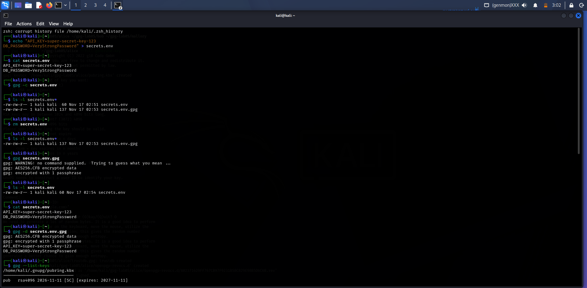
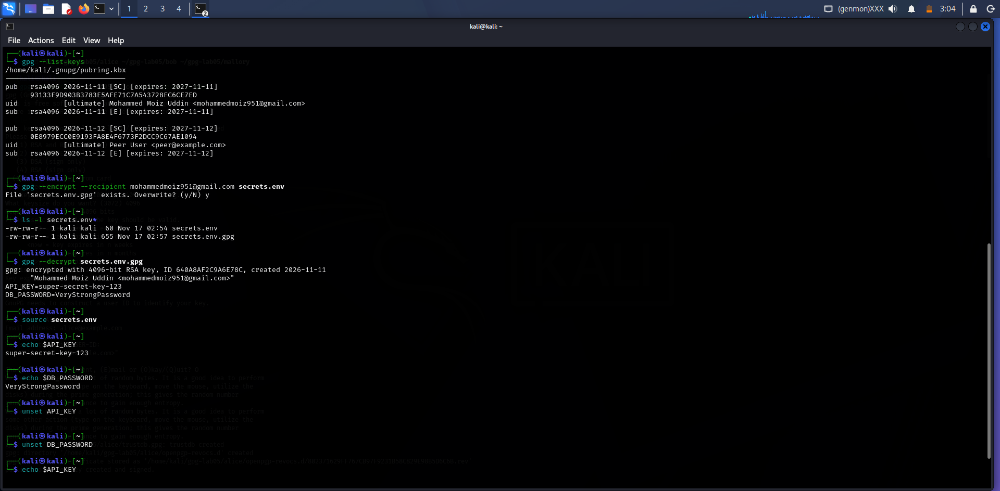
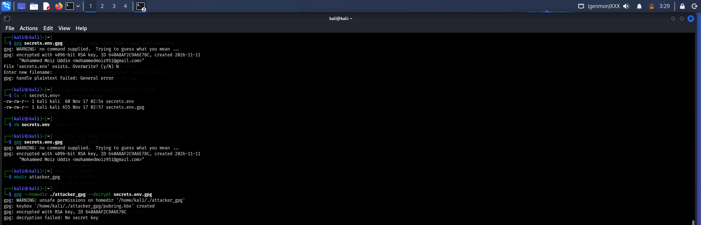
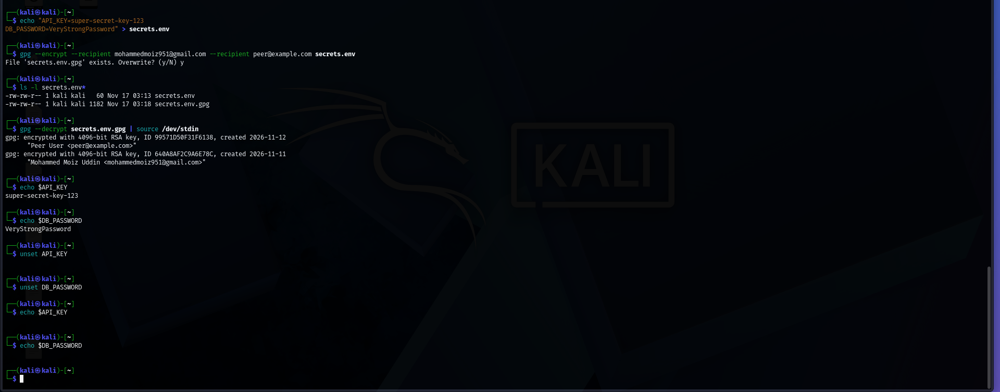

# Lab 06: Secrets Management using GPG

**Name:** Mohammed Moiz Uddin
**Environment:** Kali Linux (zsh), GnuPG

---

## 1. Objective

The aim of this lab is to understand:

- what secrets are in information systems,
- why secrets do not belong in source code or repositories,
- how sensitive data can be protected with GPG,
- the basic idea of secrets management without specialised tools.

**Scenario:** an application uses an external API. The API key must be stored locally, protected from unauthorised access, and accessible only to an authorised user.

---

## 2. Setup

GnuPG is already installed on Kali Linux. For the asymmetric steps I reused two keys already present in my keyring (generated earlier for a previous lab):

| Key | UID | Key ID | Created |
|---|---|---|---|
| Own key | Mohammed Moiz Uddin `<mohammedmoiz951@gmail.com>` | `640A8AF2C9A6E78C` | 2026-11-11 |
| Peer key | Peer User `<peer@example.com>` | `99571D50F31F6138` | 2026-11-12 |

Both are 4096-bit RSA keys.

---

## 3. Procedure and results

All commands were run on Kali Linux. The terminal sessions below are shown as captured.

### Step 1: Prepare secrets

```text
┌──(kali㉿kali)-[~]
└─$ echo "API_KEY=super-secret-key-123
DB_PASSWORD=VeryStrongPassword" > secrets.env

┌──(kali㉿kali)-[~]
└─$ cat secrets.env
API_KEY=super-secret-key-123
DB_PASSWORD=VeryStrongPassword
```

The file is 60 bytes and stored in plaintext, so it is not secure at this point.

### Step 2: Symmetric encryption (passphrase)

```text
┌──(kali㉿kali)-[~]
└─$ gpg -c secrets.env

┌──(kali㉿kali)-[~]
└─$ ls -l secrets.env*
-rw-rw-r-- 1 kali kali  60 Nov 17 02:51 secrets.env
-rw-rw-r-- 1 kali kali 137 Nov 17 02:53 secrets.env.gpg

┌──(kali㉿kali)-[~]
└─$ rm secrets.env

┌──(kali㉿kali)-[~]
└─$ ls -l secrets.env*
-rw-rw-r-- 1 kali kali 137 Nov 17 02:53 secrets.env.gpg
```

After removing the original, only the encrypted file (137 bytes) remains.

### Step 3: Decrypt the secrets

```text
┌──(kali㉿kali)-[~]
└─$ gpg secrets.env.gpg
gpg: WARNING: no command supplied.  Trying to guess what you mean ...
gpg: AES256.CFB encrypted data
gpg: encrypted with 1 passphrase

┌──(kali㉿kali)-[~]
└─$ ls -l secrets.env
-rw-rw-r-- 1 kali kali 60 Nov 17 02:54 secrets.env

┌──(kali㉿kali)-[~]
└─$ cat secrets.env
API_KEY=super-secret-key-123
DB_PASSWORD=VeryStrongPassword

┌──(kali㉿kali)-[~]
└─$ gpg -d secrets.env.gpg
gpg: AES256.CFB encrypted data
gpg: encrypted with 1 passphrase
API_KEY=super-secret-key-123
DB_PASSWORD=VeryStrongPassword
```

`gpg secrets.env.gpg` recreates `secrets.env`, and `gpg -d` prints the content to the screen. GPG reports `AES256.CFB encrypted data` and `encrypted with 1 passphrase`, which confirms symmetric encryption. The `no command supplied` warning is harmless; GPG guessed that decryption was meant.



### Step 4: Asymmetric encryption

```text
┌──(kali㉿kali)-[~]
└─$ gpg --encrypt --recipient mohammedmoiz951@gmail.com secrets.env
File 'secrets.env.gpg' exists. Overwrite? (y/N) y

┌──(kali㉿kali)-[~]
└─$ ls -l secrets.env*
-rw-rw-r-- 1 kali kali  60 Nov 17 02:54 secrets.env
-rw-rw-r-- 1 kali kali 655 Nov 17 02:57 secrets.env.gpg

┌──(kali㉿kali)-[~]
└─$ gpg --decrypt secrets.env.gpg
gpg: encrypted with 4096-bit RSA key, ID 640A8AF2C9A6E78C, created 2026-11-11
      "Mohammed Moiz Uddin <mohammedmoiz951@gmail.com>"
API_KEY=super-secret-key-123
DB_PASSWORD=VeryStrongPassword
```

GPG asked whether to overwrite the existing symmetric `secrets.env.gpg`, and I answered `y`. The new file is 655 bytes, larger than the symmetric one because it contains the RSA-encrypted session key. No shared password is needed; only the holder of the private key can decrypt.

### Step 5: Using the secrets in an application (simulation)

```text
┌──(kali㉿kali)-[~]
└─$ source secrets.env

┌──(kali㉿kali)-[~]
└─$ echo $API_KEY
super-secret-key-123

┌──(kali㉿kali)-[~]
└─$ echo $DB_PASSWORD
VeryStrongPassword

┌──(kali㉿kali)-[~]
└─$ unset API_KEY

┌──(kali㉿kali)-[~]
└─$ unset DB_PASSWORD

┌──(kali㉿kali)-[~]
└─$ echo $API_KEY


┌──(kali㉿kali)-[~]
└─$ echo $DB_PASSWORD

```

The variables were loaded into the current shell after executing source. The unset command removed these variables from the current shell session. This demonstrates temporary access to sensitive credentials.



### Step 6: Simulating a repository leak

Assuming the repository contains only `secrets.env.gpg`, I simulated an attacker with an empty GPG home directory (no private key):

```text
┌──(kali㉿kali)-[~]
└─$ secrets.env.gpg
secrets.env.gpg: command not found

┌──(kali㉿kali)-[~]
└─$ gpg secrets.env.gpg
gpg: WARNING: no command supplied.  Trying to guess what you mean ...
gpg: encrypted with 4096-bit RSA key, ID 640A8AF2C9A6E78C, created 2026-11-11
      "Mohammed Moiz Uddin <mohammedmoiz951@gmail.com>"
File 'secrets.env' exists. Overwrite? (y/N) N
Enter new filename: 
gpg: handle plaintext failed: General error

┌──(kali㉿kali)-[~]
└─$ ls -l secrets.env*
-rw-rw-r-- 1 kali kali  60 Nov 17 02:54 secrets.env
-rw-rw-r-- 1 kali kali 655 Nov 17 02:57 secrets.env.gpg

┌──(kali㉿kali)-[~]
└─$ rm secrets.env

┌──(kali㉿kali)-[~]
└─$ gpg secrets.env.gpg
gpg: WARNING: no command supplied.  Trying to guess what you mean ...
gpg: encrypted with 4096-bit RSA key, ID 640A8AF2C9A6E78C, created 2026-11-11
      "Mohammed Moiz Uddin <mohammedmoiz951@gmail.com>"

┌──(kali㉿kali)-[~]
└─$ mkdir attacker_gpg

┌──(kali㉿kali)-[~]
└─$ gpg --homedir ./attacker_gpg --decrypt secrets.env.gpg
gpg: WARNING: unsafe permissions on homedir '/home/kali/./attacker_gpg'
gpg: keybox '/home/kali/./attacker_gpg/pubring.kbx' created
gpg: encrypted with RSA key, ID 640A8AF2C9A6E78C
gpg: decryption failed: No secret key
```

The attacker can see which key ID the file was encrypted for, but cannot decrypt it: `decryption failed: No secret key`. Access is not possible without the private key.

Notes on the earlier lines in this session:
- The first command was a typing mistake (I entered the filename without `gpg`), so the shell returned `command not found`.
- The `N` answer to the overwrite prompt produced `handle plaintext failed: General error`. This is GPG refusing to overwrite the existing `secrets.env`, not a real failure. I removed the file and ran the command again successfully.
- The `unsafe permissions` warning only means the new directory was not set to `chmod 700`; it does not affect the result.



---

## 4. Additional challenges

### Multiple recipients

```text
┌──(kali㉿kali)-[~]
└─$ echo "API_KEY=super-secret-key-123
DB_PASSWORD=VeryStrongPassword" > secrets.env

┌──(kali㉿kali)-[~]
└─$ gpg --encrypt --recipient mohammedmoiz951@gmail.com --recipient peer@example.com secrets.env
File 'secrets.env.gpg' exists. Overwrite? (y/N) y

┌──(kali㉿kali)-[~]
└─$ ls -l secrets.env*
-rw-rw-r-- 1 kali kali   60 Nov 17 03:13 secrets.env
-rw-rw-r-- 1 kali kali 1182 Nov 17 03:18 secrets.env.gpg
```

The file grew from 655 to 1182 bytes because it now holds one encrypted session key per recipient. Either recipient can decrypt it with their own private key, and no passphrase or key is shared between them.

### Automatic use (script)

```text
┌──(kali㉿kali)-[~]
└─$ gpg --decrypt secrets.env.gpg | source /dev/stdin
gpg: encrypted with 4096-bit RSA key, ID 99571D50F31F6138, created 2026-11-12
      "Peer User <peer@example.com>"
gpg: encrypted with 4096-bit RSA key, ID 640A8AF2C9A6E78C, created 2026-11-11
      "Mohammed Moiz Uddin <mohammedmoiz951@gmail.com>"

┌──(kali㉿kali)-[~]
└─$ echo $API_KEY
super-secret-key-123

┌──(kali㉿kali)-[~]
└─$ echo $DB_PASSWORD
VeryStrongPassword

┌──(kali㉿kali)-[~]
└─$ unset API_KEY

┌──(kali㉿kali)-[~]
└─$ unset DB_PASSWORD

┌──(kali㉿kali)-[~]
└─$ echo $API_KEY


┌──(kali㉿kali)-[~]
└─$ echo $DB_PASSWORD

```

The decrypt output lists both recipient keys, confirming the multi-recipient encryption, and the secrets were loaded straight into the shell without writing a plaintext file. After `unset`, both variables printed empty lines again.




---

## 5. Reflection

### 1. Why don't secrets belong in the source code?

Git history is permanent: even if a secret is deleted in a later commit, it stays in old commits and can be recovered. Repositories are accessible to many people and systems (developers, CI/CD, forks, backups, third-party tools), so a secret in code is exposed to all of them. Leaked repositories are routinely scraped by bots for API keys and passwords. Hard-coded secrets are also difficult to rotate, are often identical across environments, and leave no audit trail of who used them.

### 2. What is the difference between symmetric and asymmetric secret encryption?

Symmetric encryption (`gpg -c`) uses a single shared passphrase for both encrypting and decrypting. It is simple, but everyone who needs access must know the passphrase, so it has to be shared and protected, and anyone who has it has full access. Asymmetric encryption (`gpg --encrypt --recipient`) encrypts with the recipient's public key and decrypts with their private key. No secret needs to be shared, access is per person, and extra recipients can be added without exchanging passwords. The cost is that private keys must be managed and protected. In practice GPG uses hybrid encryption: the data is encrypted with a random symmetric session key, and that key is then encrypted with each recipient's public key. This is why the file in this lab grew with each added recipient (655 bytes for one, 1182 for two).

### 3. What happens if we lose the private key?

The data encrypted for that key is permanently unrecoverable; there is no backdoor. Mitigations are an offline, secured backup of the private key, a revocation certificate generated in advance (`gpg --gen-revoke`), and encrypting to multiple recipients, for example a break-glass key held by the security team. After a loss, the secrets themselves should also be rotated, because old ciphertext copies may still exist. A related risk is a private key without a passphrase: anyone who copies the `~/.gnupg` directory could decrypt everything. In my captured sessions no passphrase prompt appeared for the private key, which suggests either a cached gpg-agent session or an unprotected key, and in a real setup the key should be passphrase-protected.

### 4. How would you handle this in a larger enterprise?

I would use a dedicated secrets management platform (HashiCorp Vault, AWS Secrets Manager or Azure Key Vault) instead of files encrypted by hand:

- Centralised access control (RBAC/IAM) and full audit logging of who accessed which secret.
- Short-lived, dynamically generated credentials instead of static keys.
- Automated rotation and revocation.
- Secrets injected at runtime, never baked into images, repositories or config files.
- Secret scanning in pre-commit hooks and CI (for example gitleaks or trufflehog).
- Where secrets must live in Git, an encrypted workflow such as SOPS with KMS/HSM-backed keys.

---

## 6. Conclusion

This lab showed that secrets such as API keys and database passwords should never be stored in plaintext in source code or repositories, and that GPG offers a simple way to protect them without specialised tools. Symmetric encryption (`gpg -c`) protects a file with a shared passphrase, while asymmetric encryption removes the need to share a password and allows several recipients to decrypt the same file with their own private keys. The repository leak simulation confirmed the benefit: an attacker holding only `secrets.env.gpg` and no private key gets `decryption failed: No secret key`.

The lab also made the limits of this approach clear. The plaintext still has to exist at runtime, there is no automatic rotation, no central audit trail and no easy way to revoke one user's access, and everything depends on how well the private key is protected and backed up. GPG is therefore suitable for demonstrations and small workflows, while production environments should use dedicated tools such as HashiCorp Vault, SOPS or AWS Secrets Manager.
